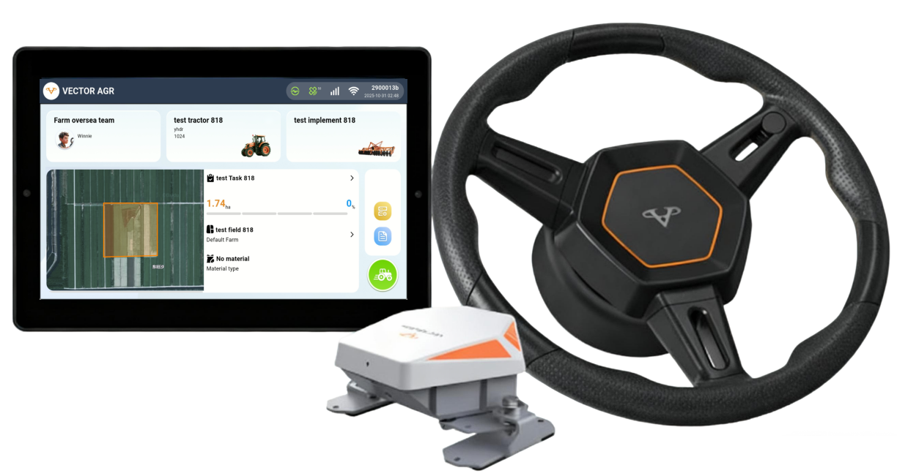

# I. Haftungsausschluss

## 1. Haftungsausschluss

Dieses Dokument beschreibt Produkte der Heilongjiang Huida Technology Co., Ltd. Es räumt keine Rechte an Patenten, Marken, Urheberrechten oder sonstigen Schutzrechten von Huida oder Dritten ein – weder ausdrücklich noch stillschweigend.

Über die Pflichten aus den Verkaufsbedingungen hinaus übernimmt Huida keine Haftung. Huida gibt keine Zusicherung, dass sich die Produkte für einen bestimmten Zweck eignen oder keine Schutzrechte Dritter verletzen. Technische Daten und Produktbeschreibungen können sich jederzeit ohne Ankündigung ändern.

Alle Rechte vorbehalten ©2019–2025, Heilongjiang Huida Technology Co., Ltd.

## 2. Technik und Service

Wenn Sie die benötigten Informationen in diesem Handbuch nicht finden, wenden Sie sich an den Techniker, der das System eingebaut hat.

Huida-Kundendienst (China): 400-888-0787.

Die gezeigten Bildschirme stammen aus einer Testversion. Maßgeblich sind die Funktionen, die tatsächlich auf Ihrem Gerät angezeigt werden.

# II. Hinweise zur Produktverwendung

## 1. Hinweise zur Produktverwendung

- Lesen Sie vor der Verwendung alle mitgelieferten Unterlagen sorgfältig durch, um Bedienung und Vorsichtsmaßnahmen zu verstehen.
- Zerlegen Sie das Gerät nicht selbst. Lassen Sie das nur von Fachpersonal machen. Vor jeder Demontage ist die Stromversorgung abzuschalten; das Gerät darf niemals unter Spannung zerlegt werden.
- Schließen Sie das Gerät nur genau nach den Vorgaben dieses Handbuchs an. Falsche Anschlüsse können Geräteschäden und Sicherheitsrisiken verursachen.
- Achten Sie auf die Anforderungen an die Spannungsversorgung: Die Versorgungsspannung muss zwischen 9 und 30 V liegen.
- Prüfen Sie alle Kabelbäume. Beschädigte Kabelbäume sind rechtzeitig zu ersetzen, um Funktionsstörungen und Sicherheitsrisiken zu vermeiden.
- Öffnen Sie die Gehäuse der Komponenten nicht selbst; andernfalls entfällt der Anspruch auf Reparatur.
- Das Produkt hat keine aktive Hinderniserkennung. Während das automatische Lenksystem arbeitet, muss daher immer eine Person anwesend sein und die Umgebung überwachen.
- Das automatische Lenksystem steuert nicht die Fahrgeschwindigkeit. Die Bedienperson muss die Geschwindigkeit selbst in einem sicheren Bereich halten.
- Bei Tests und Kalibrierung übernimmt das System die Lenkung. Lenkrad, Räder oder andere Fahrzeugteile können sich dabei unerwartet bewegen. Stellen Sie beim Starten des Fahrzeugs und beim Aktivieren des Systems sicher, dass sich niemand im Gefahrenbereich befindet.
- Das automatische Lenken darf auf öffentlichen Straßen und an öffentlichen Orten nicht aktiviert werden.
- Prüfen Sie vor jeder Verwendung, ob Komponenten beschädigt sind oder Auffälligkeiten zeigen. Das Produkt darf nur verwendet werden, wenn alle Teile in ordnungsgemäßem Zustand sind. Mängel sind umgehend zu beheben oder dem Kundendienst zu melden.
- Für Unfälle durch vorschriftswidrige Bedienung während des automatischen Lenkens haftet die Heilongjiang Huida Technology Co., Ltd. nicht.

## 2. Sicherheitshinweise

| | |
|:--:|----|
|  | Bei aktivem automatischem Lenken darf der Fahrer die Kabine keinesfalls verlassen. |
|  | Das automatische Lenksystem nur bei der Feldarbeit verwenden – nicht auf Straßen, Wegen oder anderen Flächen. |
|  | Verwenden Sie das Gerät nur gemäß dieser Anleitung; eigenmächtiges Ändern von Softwareparametern ist untersagt. |
|  | Wird das Gerät längere Zeit nicht benutzt, trennen Sie die Stromversorgung, damit die Batterie nicht entladen wird. |
|  | Schützen Sie die Geräte in der Kabine vor Wasser, insbesondere beim Reinigen des Fahrzeugs. |
|  | Das System steuert nicht die Geschwindigkeit; die Bedienperson muss die Geschwindigkeit selbst anpassen. |
|  | Unbefugtes Zerlegen des Geräts ist verboten; andernfalls entfällt die Garantie. |

# III. Produktbeschreibung

## 1. Produktübersicht

Das HD818 ist ein automatisches Lenksystem mit GNSS-Navigation, das **Huida Technology** selbst entwickelt und herstellt. Ein Lenkmotor mit hohem Drehmoment dreht das Lenkrad. Das System eignet sich für Traktoren, Pflanzmaschinen, Pflanzenschutzspritzen, Raupentraktoren und andere Landmaschinen.

Das System hat sich in der Praxis bewährt. Alle nötigen Anbauteile sind dabei, sodass es in jede Landmaschine mit Lenkrad passt.

Vorteile:

- Genauere Arbeit und damit bessere Qualität.
- Von Hand versucht man, wenig zu überlappen und nichts auszulassen. Das Lenksystem fährt präzise Anschluss ohne Überlappung – das spart deutlich Zeit und Betriebsmittel.
- Der Fahrer wird entlastet und kann länger arbeiten, auch nachts.
- Die Bedienung ist einfach, auch weniger erfahrene Fahrer kommen schnell zurecht.

## 2. Hauptkomponenten

| Komponente | Abbildung |
|:--:|----|
| GNSS-Antenne | 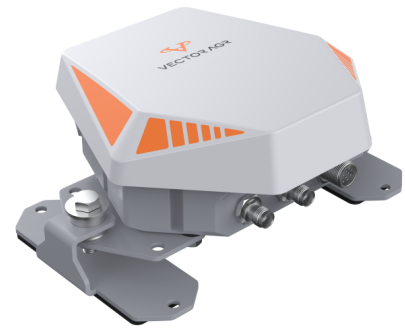 |
| Terminal (Display) | 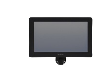 |
| Elektrischer Lenkmotor |  |
| Gyroskop (Lenkwinkelsensor) | 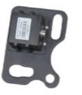 |

# IV. Bedienung

## 1. Terminal

So ist die Oberfläche aufgebaut:

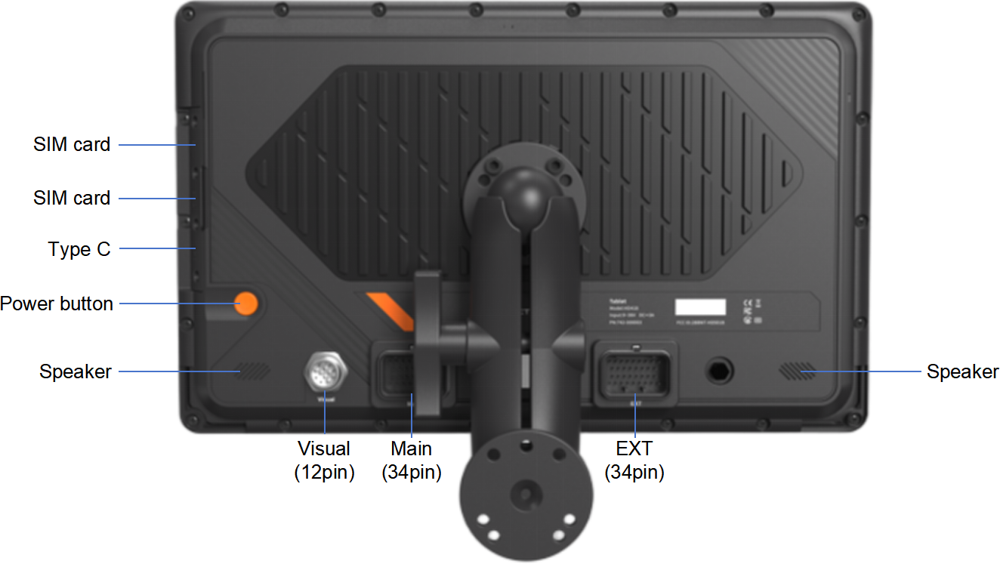

## 2. Ein-/Ausschalten

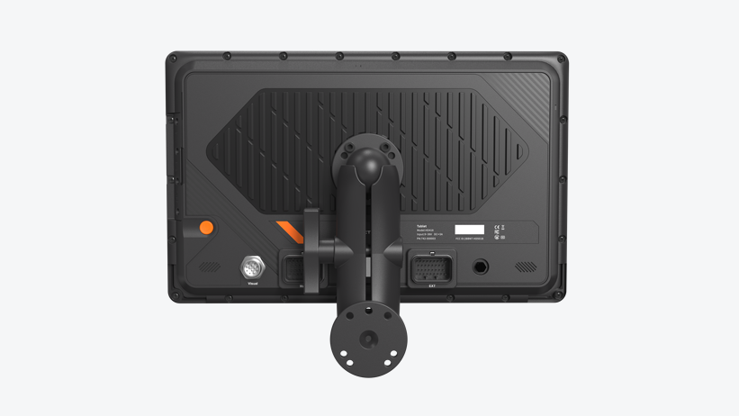

Halten Sie die Ein-/Aus-Taste am Terminal 3 Sekunden gedrückt, um das Navigationssystem einzuschalten.

## 3. Anmeldung

So melden Sie das Terminal auf Ihren Namen an:

1. Unter [www.huidaag.com/login](https://www.huidaag.com/login?redirect=/farm) ein Konto anlegen.
2. Am Handy die App **HD Ag** installieren und dort einloggen.
3. Am Terminal auf die **Anmeldekarte** tippen. In der App unten auf **Mein** und oben rechts auf das Scan-Symbol tippen, dann den QR-Code am Terminal scannen. Danach läuft das Terminal auf Ihren Namen.

   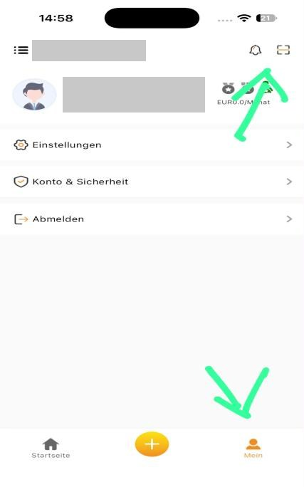

Über das Benutzerkonto werden Fahrer- und Arbeitsdaten gespeichert und mit der Plattform abgeglichen.

Ohne Anmeldung sind alle Karten auf dem Hauptbildschirm grau. Die **Anmeldekarte** finden Sie oben links auf dem Hauptbildschirm.

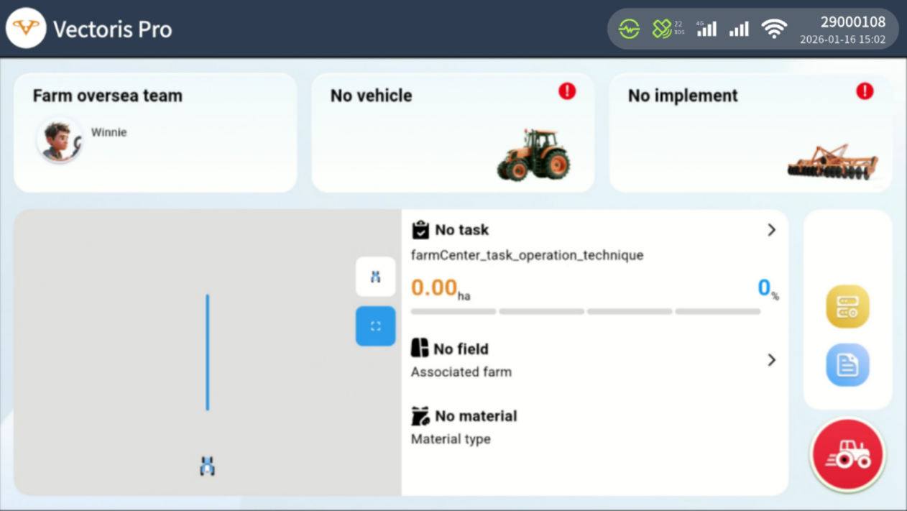

Es gibt zwei Arten der Anmeldung:

**Per QR-Code** – den QR-Code mit der **HD-Ag-App** scannen. Für Nutzer mit eigenem Konto.

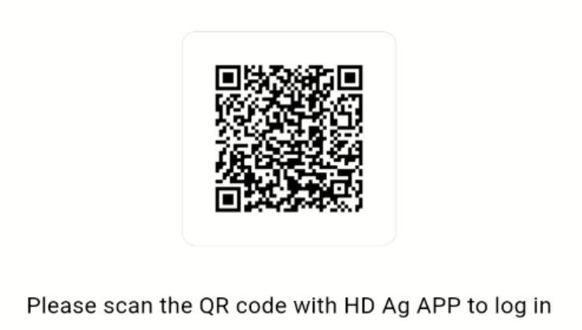

**Per Autorisierungscode** – einen Code eingeben, den der Betrieb auf der Plattform vergeben hat. Für Nutzer ohne eigenes Konto, die nur vorübergehend fahren (z. B. Aushilfsfahrer).

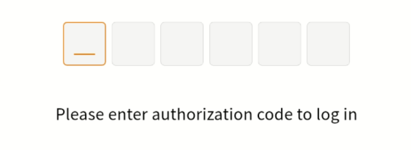

## 4. Karten auf dem Hauptbildschirm

Auf dem Hauptbildschirm stehen Karten für **Fahrzeug**, **Anbaugerät**, **Aufgabe**, **Feld** und **Betriebsmittel**. So sehen Sie auf einen Blick, wie alles eingestellt ist und welche Arbeit ansteht.

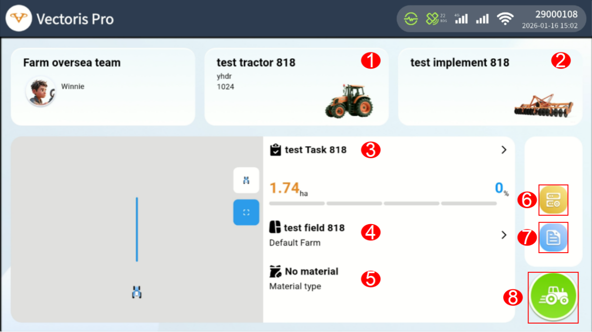

1. **Fahrzeugkarte:** Zeigt das aktuell gewählte Fahrzeug. Antippen öffnet die **Fahrzeugliste**. Ist kein Fahrzeug eingerichtet, erscheint das Warnsymbol . Ohne Fahrzeug lässt sich der **Arbeitsbildschirm** nicht öffnen.

   

2. **Anbaugerätekarte:** Zeigt das aktuell gewählte Anbaugerät. Antippen öffnet die **Anbaugeräteliste**. Ist kein Anbaugerät eingerichtet oder passt der Gerätetyp nicht zur Aufgabe, erscheint ein Hinweis und der **Arbeitsbildschirm** lässt sich nicht öffnen.

   

3. **Aufgabenkarte:** Zeigt eine Zusammenfassung der laufenden Aufgabe. Antippen öffnet die **Aufgabenliste**. Ohne Aufgabe lässt sich der **Arbeitsbildschirm** nicht öffnen.

4. **Feldkarte:** Zeigt das Feld der aktuellen Aufgabe, links mit Satellitenbild. Antippen öffnet die **Feldliste**. Beim Anlegen einer Aufgabe in **Vectoris Pro** muss ihr ein Feld zugewiesen werden.

5. **Betriebsmittelkarte:** Zeigt die Betriebsmittel (Saatgut, Dünger, Spritzmittel …) zum aktuellen Anbaugerät. Die Angabe ist freiwillig; Antippen öffnet die **Betriebsmittelliste**.

6. **Symbol Versionsverwaltung:** Öffnet die Versionsverwaltung. Dort sehen Sie die Versionen aller angeschlossenen Geräte und wählen die Art des Updates.

7. **Symbol Datenübertragung:** Öffnet den Datenmanager für den Datenaustausch mit anderen Terminals oder externen Speichern (z. B. USB-Stick).

8. **Symbol Arbeitsbildschirm:** Öffnet den Arbeitsbildschirm, sobald Fahrzeug, Anbaugerät und Aufgabe eingerichtet sind.

## 5. Fahrzeugliste

Tippen Sie auf die Fahrzeugkarte, um die Fahrzeugauswahl zu öffnen.

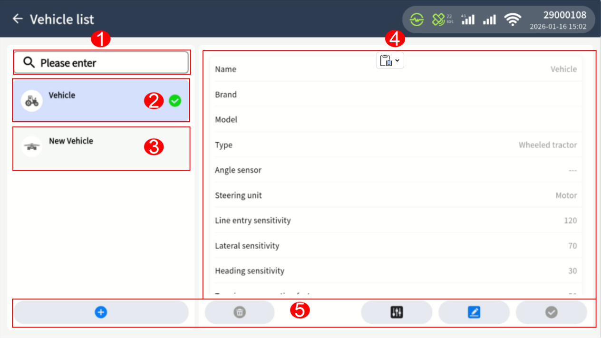

1. Fahrzeuge über Stichwörter suchen.
2. Dieses Symbol kennzeichnet das **derzeit aktive Fahrzeug**.
3. Fahrzeug auswählen: Eintrag in der Liste antippen.
4. Zusammenfassung der **Fahrzeugdaten**; nach unten scrollen für mehr Details.
5. Ausgewähltes Fahrzeug verwalten: anlegen, löschen, bearbeiten, aktivieren oder kalibrieren.

### 5.1 Neues Fahrzeug anlegen

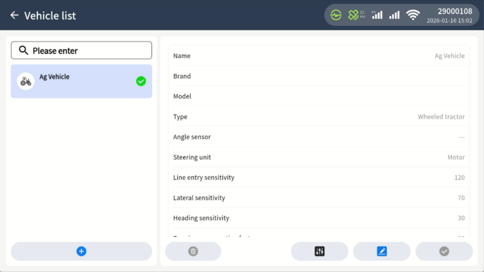

Tippen Sie auf , um ein neues Fahrzeug anzulegen.

#### 5.1.1 Fahrzeugdaten

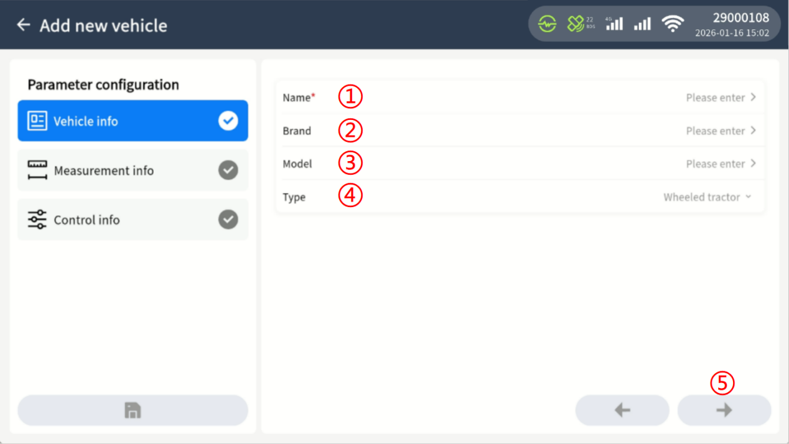

| Nr. | Feld | Beschreibung |
|:--:|----|----|
| 1 | Name | Name des Fahrzeugs (Pflichtfeld) |
| 2 | Marke | Marke des Fahrzeugs |
| 3 | Modell | Modell des Fahrzeugs |
| 4 | Typ | Fahrzeugtyp: Radtraktor / Kettentraktor / Knicklenker / Reispflanzmaschine / Erntemaschine / selbstfahrende Spritze |
| 5 | → | Weiter zu **Maße** |

#### 5.1.2 Maße

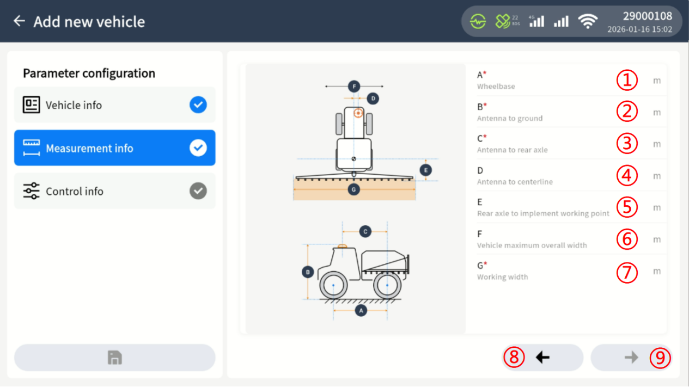

| Nr. | Feld | Beschreibung |
|:--:|----|----|
| 1 | Radstand | Abstand zwischen Vorder- und Hinterachsmitte, in m (Pflichtfeld) |
| 2 | Antenne – Boden | Höhe der Antennenoberkante über dem Boden, in m (Pflichtfeld) |
| 3 | Antenne – Hinterachse | Waagrechter Abstand der Antenne zur Hinterachse, in m (Pflichtfeld) |
| 4 | Antenne – Mittellinie | Seitlicher Abstand der Antenne zur Fahrzeugmitte, in m |
| 5 | Hinterachse – Arbeitspunkt | Abstand Hinterachse bis Dreipunkt-Kupplung, in m |
| 6 | Max. Gesamtbreite | Breite des Geräts von Kante zu Kante, in m |
| 7 | Arbeitsbreite | Tatsächliche Arbeitsbreite vom äußersten linken bis zum äußersten rechten Arbeitspunkt, in m. Danach richtet sich der Abstand der Führungslinien (AB-Linie usw.). (Pflichtfeld) |
| 8 |  | Zurück zu **Fahrzeugdaten** |
| 9 |  | Weiter zu **Lenkeinstellungen** |

#### 5.1.3 Lenkeinstellungen

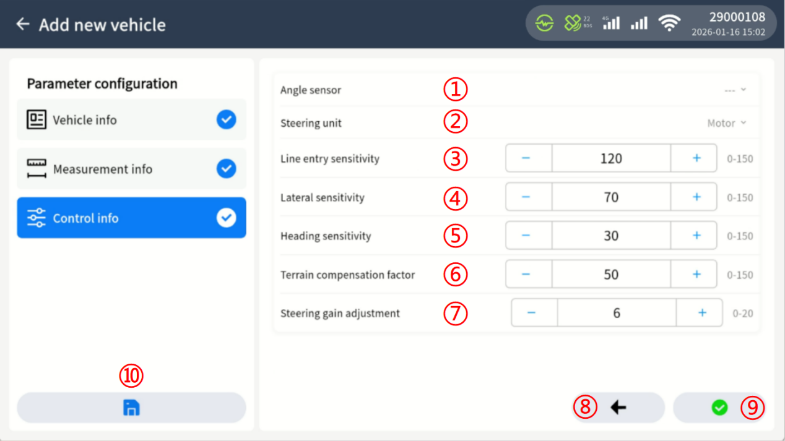

| Nr. | Feld | Beschreibung |
|:--:|----|----|
| 1 | Winkelsensor | Einbaulage des Winkelsensors: … / Etikett oben / Etikett unten |
| 2 | Lenkeinheit | Art der Lenkung: Motor / Hydraulikventil / Steer Ready CAN |
| 3 | Empfindlichkeit Linieneinfahrt | Wie schnell das Fahrzeug auf die Führungslinie einschwenkt |
| 4 | Seitliche Empfindlichkeit | Wie früh das System bei seitlicher Abweichung gegenlenkt |
| 5 | Richtungsempfindlichkeit | Wie stark das System bei Richtungsabweichung lenkt |
| 6 | Geländeausgleich | Wie stark das System Hang und Unebenheiten ausgleicht |
| 7 | Lenkverstärkung | Wie schnell und oft das Lenkrad nachkorrigiert |
| 8 |  | Zurück zu **Maße** |
| 9 | √ | Fahrzeug aktivieren und Kalibrierung starten |
| 10 | Speichern | Aktuelle Einstellungen speichern |

> 
>
> Sie können die Kalibrierung zunächst überspringen und das Fahrzeug trotzdem fertig anlegen. Mit einem nicht kalibrierten Fahrzeug lässt sich der Arbeitsbildschirm aber nicht öffnen.
>
> Wählen Sie das Fahrzeug später in der Liste aus, fragt das System erneut nach der Kalibrierung. Erst danach wird das Fahrzeug aktiviert.

## 6. Anbaugeräteliste

Tippen Sie auf die Anbaugerätekarte, um die Anbaugeräteliste zu öffnen.

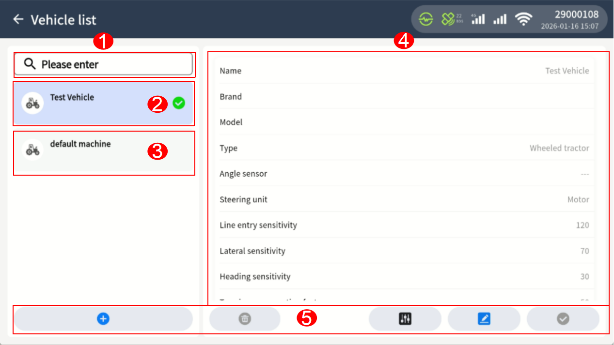

1. Anbaugeräte über Stichwörter suchen.
2. Dieses Symbol kennzeichnet das **derzeit aktive Anbaugerät**.
3. Anbaugerät auswählen: Eintrag in der Liste antippen.
4. Zusammenfassung der **Anbaugerätedaten**; nach unten scrollen für mehr Details.
5. Ausgewähltes Anbaugerät verwalten: anlegen, löschen, bearbeiten oder aktivieren.

### 6.1 Neues Anbaugerät anlegen

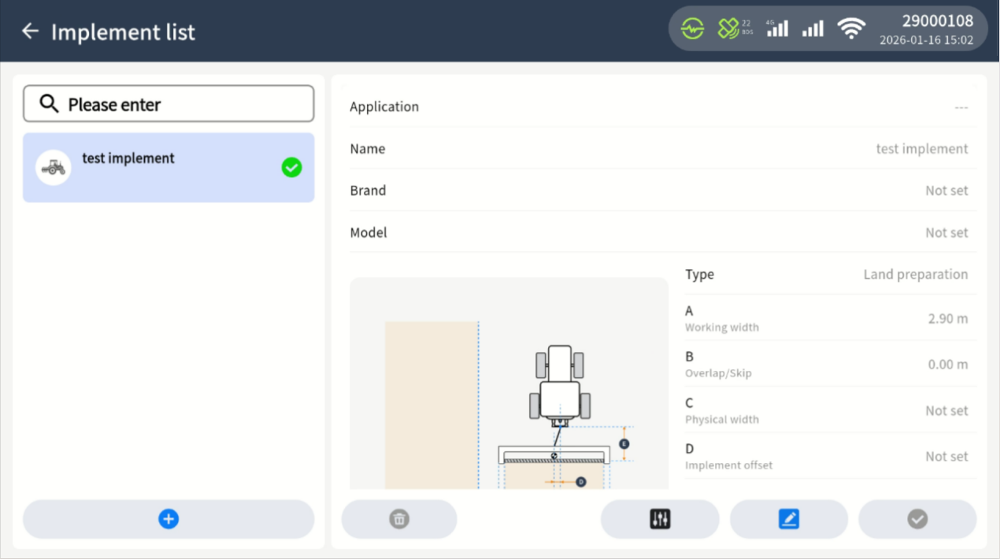

Tippen Sie auf , um Gerätedaten und Maße einzugeben.

#### 6.1.1 Anbaugerätedaten

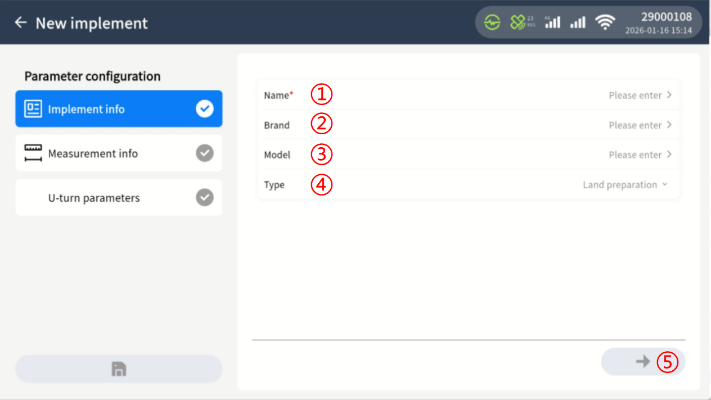

| Nr. | Feld | Beschreibung |
|:--:|----|----|
| 1 | Name | Name des Anbaugeräts |
| 2 | Marke | Marke des Anbaugeräts |
| 3 | Modell | Modell des Anbaugeräts |
| 4 | Typ | Gerätetyp: Bodenbearbeitung / Aussaat / Hacken / Pflanzenschutz / Düngung / Ernte / Gemüsepflanzung / Bewässerung / Transport / Planierschild / Sonstiges |
| 5 | → | Weiter zu **Maße** |

#### 6.1.2 Maße

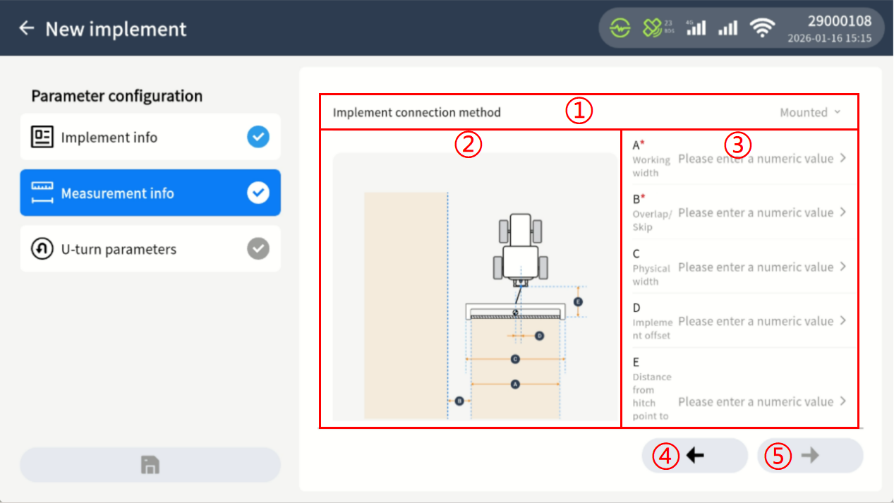

Wählen Sie die passende **Anbauart** und geben Sie die gemessenen Werte ein: **Arbeitsbreite**, **Überlappung / Lücke**, **Versatz**, **Gerätebreite** und **Abstand Kupplungspunkt – Arbeitspunkt**.

| Nr. | Feld | Beschreibung |
|:--:|----|----|
| 1 | Anbauart | Gezogen / angebaut |
| 2 | Skizze | Zeigt, wo gemessen wird |
| 3 | Gerätemaße | A Arbeitsbreite, B Überlappung / Lücke, C Gerätebreite, D Geräteversatz, E Abstand Kupplungspunkt – Arbeitspunkt. Einheit je nach Einstellung, standardmäßig Meter. |
| 4 | ← | Zurück zu **Anbaugerätedaten** |
| 5 | → | Weiter zu **Wendeeinstellungen** |

##### 6.1.2.1 Anbauart

Wählen Sie, wie das Gerät mit dem Fahrzeug verbunden ist: **gezogen / angebaut**.

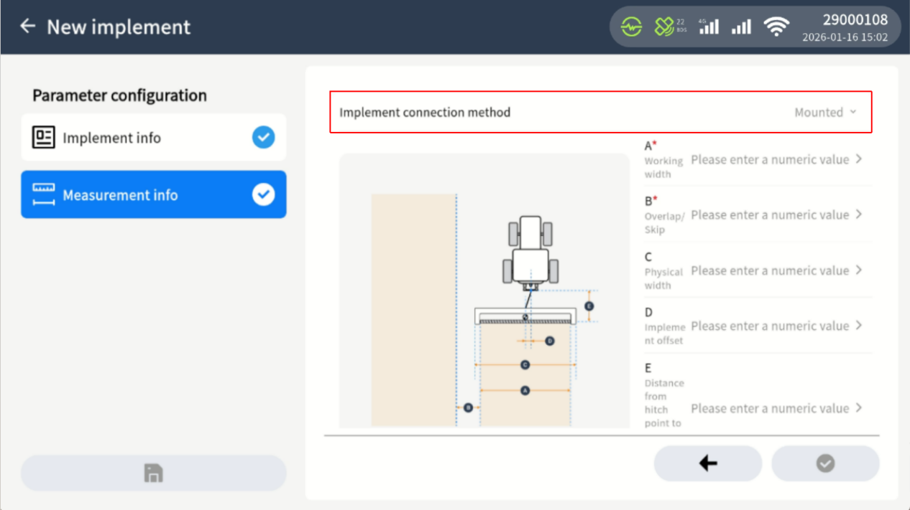

##### 6.1.2.2 Arbeitsbreite

Messen Sie vor dem Einsatz die tatsächliche Arbeitsbreite, wie im Bild gezeigt: vom äußersten linken bis zum äußersten rechten Arbeitspunkt des Geräts. Messen Sie mehrmals und nehmen Sie den Mittelwert. Ist der Wert ungenau, stimmt später der Anschluss zwischen den Bahnen nicht. Geben Sie dann die gemessene Breite ein.

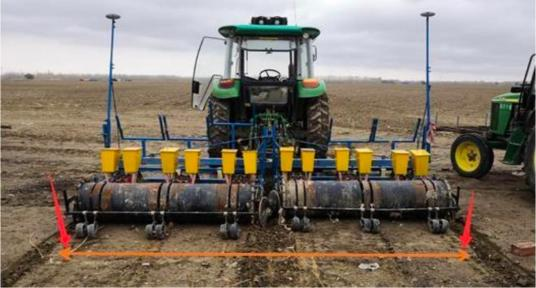

##### 6.1.2.3 Spurabstand

- **Spurabstand:** Abstand zwischen zwei benachbarten Arbeitsbahnen.
- **Linker Anschluss:** die Nachbarbahn links vom Fahrer.
- **Rechter Anschluss:** die Nachbarbahn rechts vom Fahrer.
- **Überlappung (Overlap):** Streifen, der doppelt bearbeitet wird.
- **Lücke (Skip):** Streifen, der zwischen zwei Bahnen unbearbeitet bleibt.

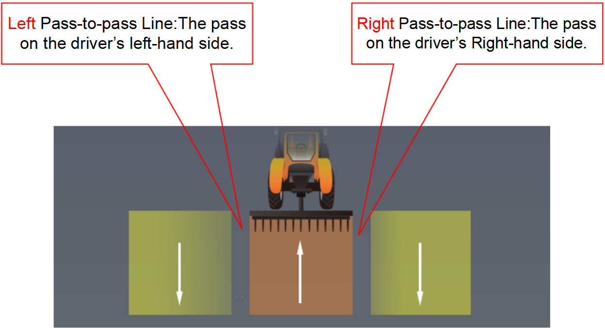

##### 6.1.2.4 Gerätebreite

Die **Gerätebreite** ist der Abstand zwischen der äußersten linken und rechten Kante des Anbaugeräts (nicht die Arbeitsbreite).

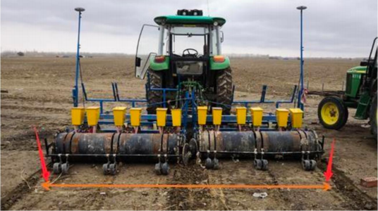

 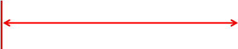

##### 6.1.2.5 Geräteversatz

Der **Geräteversatz** ist der seitliche Abstand zwischen der Mitte des Fahrzeugs und der Mitte des Anbaugeräts. Liegen beide Mitten übereinander, ist der Versatz **0**. Markieren Sie zum Messen die Mitte von Fahrzeug und Gerät.

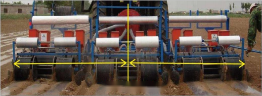

##### 6.1.2.6 Abstand Kupplungspunkt – Arbeitspunkt

Abstand vom **Kupplungspunkt** (dort, wo das Gerät am Fahrzeug angehängt ist) bis zum Arbeitspunkt des Geräts.

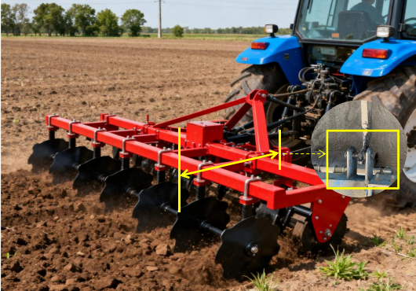

#### 6.1.3 Wendeeinstellungen

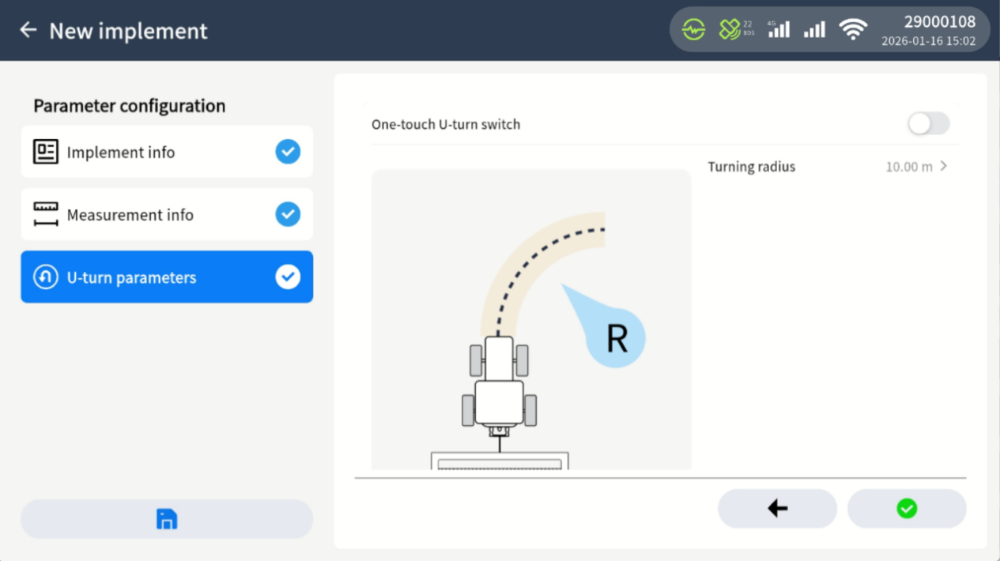

| Nr. | Feld | Beschreibung |
|:--:|----|----|
| 1 | Automatische Wende | Schaltfläche für die automatische Wende ein- oder ausblenden |
| 2 | Wenderadius | Kleinster Wenderadius des Fahrzeugs für die automatische Wende |
| 4 | ← | Zurück zu **Maße** |
| 5 | √ | Anbaugerät aktivieren und speichern |
| 6 | Speichern | Aktuelle Einstellungen speichern |

## 7. Feldverwaltung

Auf dem Hauptbildschirm sehen Sie das aktuelle Feld mit Satellitenbild. Tippen Sie auf die **Feldkarte**, um die Feldliste zu öffnen; dort legen Sie Felder an, löschen oder bearbeiten sie.

### 7.1 Feldliste

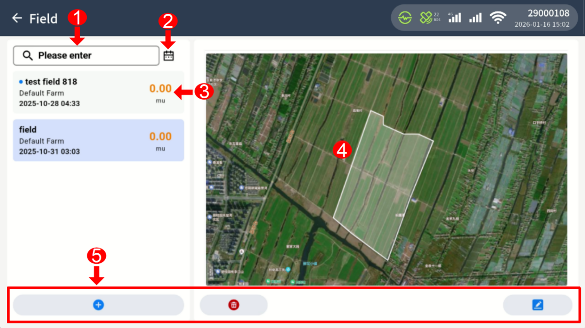

1. Felder über Stichwörter suchen.
2. Sortierung umschalten: **nach Entfernung / nach Zeit**.
3. Kennzeichnet das Feld der aktuellen Aufgabe.
4. Satellitenbild des gewählten Feldes.
5. Felder anlegen, löschen oder bearbeiten.

### 7.2 Neues Feld anlegen

Tippen Sie auf **＋**.

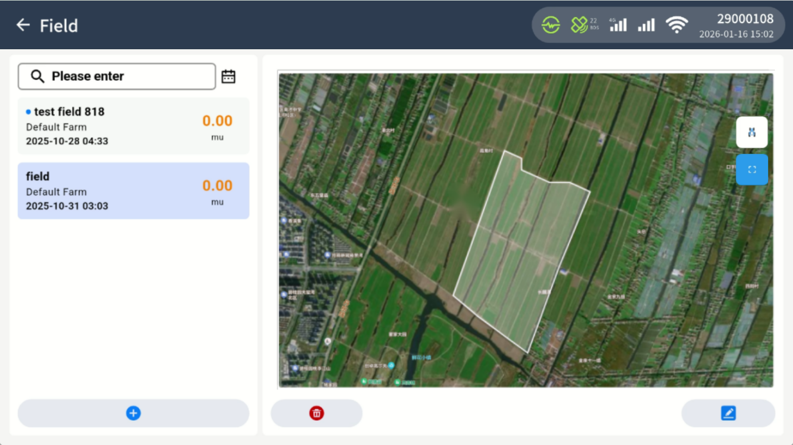

Es öffnet sich ein Fenster zum Anlegen eines Feldes.

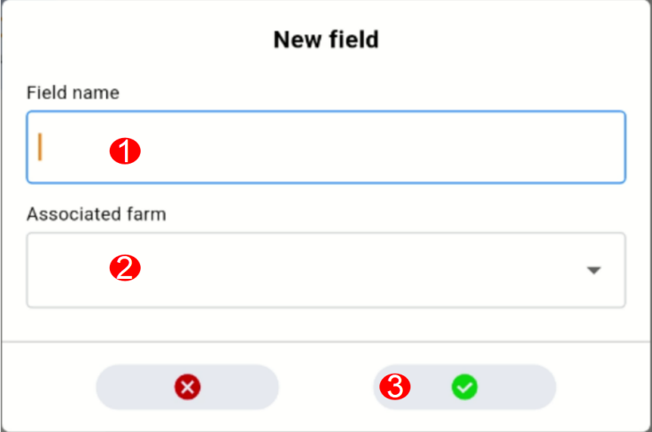

1. Eindeutigen **Feldnamen** eingeben.
2. **Betrieb** auswählen. Die Liste wird mit der Plattform abgeglichen; Betriebe können auch in der Handy-App angelegt werden.
3.  tippen, um das Feld anzulegen. Das neue Feld erscheint in der Liste und ist ausgewählt.
4.  tippen, um abzubrechen, ohne ein Feld anzulegen.

### 7.3 Feld löschen

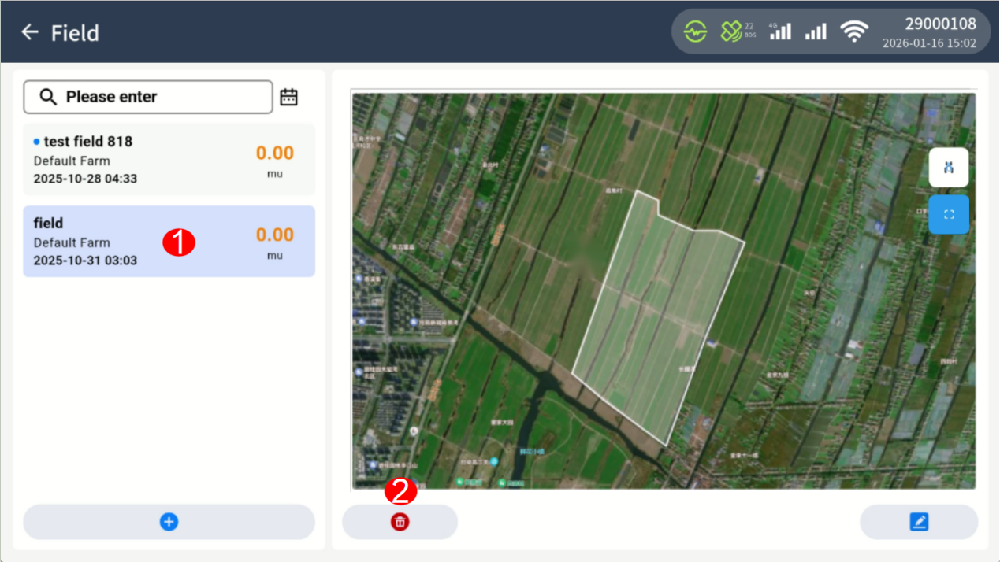

Wählen Sie das Feld in der Liste aus und tippen Sie auf **Löschen**. Bestätigen Sie mit . Die Feldliste wird automatisch aktualisiert.

> **Hinweise:**
>
> - Mit dem Feld werden auch alle zugehörigen Aufgaben gelöscht.
> - Prüfen Sie deshalb vorher, ob im Feld noch offene Aufgaben sind.
> - Das Feld der aktuellen Aufgabe kann nicht gelöscht werden; **Löschen** ist dann ausgegraut.

## 8. Arbeitsbildschirm

Voraussetzungen: Sie sind angemeldet, das Fahrzeug ist angelegt und kalibriert, das Anbaugerät ist angelegt und eine Aufgabe ist erstellt. Tippen Sie dann auf das Symbol **Arbeitsbildschirm**.

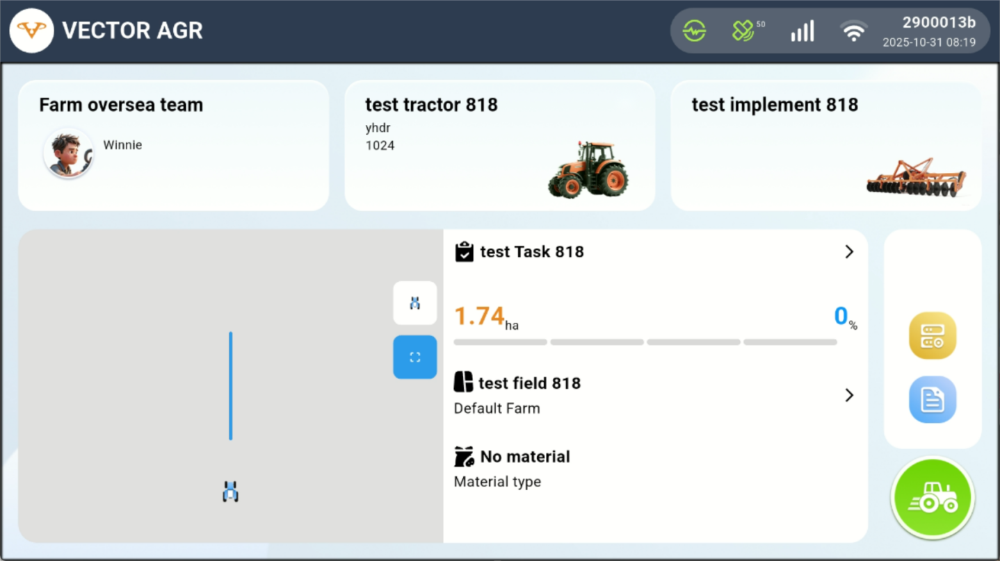

Der **Arbeitsbildschirm** öffnet sich.

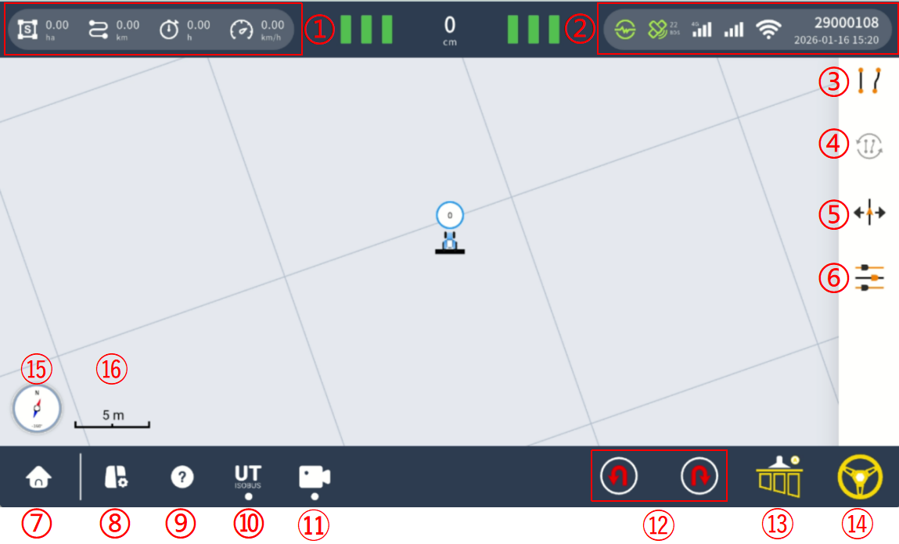

1. **Statusleiste:** zeigt bearbeitete Fläche, gefahrene Strecke, Einsatzzeit und Durchschnittsgeschwindigkeit. Ein Tippen auf die Symbole oben links öffnet ein Fenster mit den Aufgabendaten. Ein weiteres Tippen, egal wo, schließt es wieder.
2. **Einstellungen:** zeigt Satellitenstatus, SIM-Status, Geräte-ID und Uhrzeit. Ein Tippen auf die Symbole oben rechts öffnet die Einstellungen, ein weiteres Tippen schließt sie.
3. **Referenzlinie:** neue Führungslinie anlegen.
4. **Referenzlinie wechseln:** zu einer anderen Führungslinie wechseln.
5. **Feinverschiebung:** Lage der Führungslinie fein verschieben.
6. **Lenkparameter:** Lenk- und Navigationseinstellungen des Fahrzeugs anpassen.
7. **Wendeeinstellungen:** automatische Wende ein- oder ausschalten.
8. **Startseite:** zurück zum Hauptbildschirm.
9. **Feldmanager:** Details des aktuellen Feldes ansehen und bearbeiten.
10. **Hilfe:** Fernwartung, KI-Sprachassistent, Downloads und Videoanleitungen.
11. **ISOBUS-Einstellungen:** ISOBUS-Parameter anpassen.
12. **Kamera:** Kamerabild ein- oder ausschalten.
13. **Automatische Wende:** Wende nach links oder rechts auslösen.
14. **Spuranzeige:** bearbeitete Spuren ein- oder ausblenden.
15. **Lenkautomatik:** automatisches Lenken ein- oder ausschalten.
16. **Kompass:** zeigt die aktuelle Fahrtrichtung.
17. **Maßstab:** Kartenmaßstab.

## 9. Feldmanager

Tippen Sie unten im Arbeitsbildschirm auf das Symbol **Feldverwaltung**.

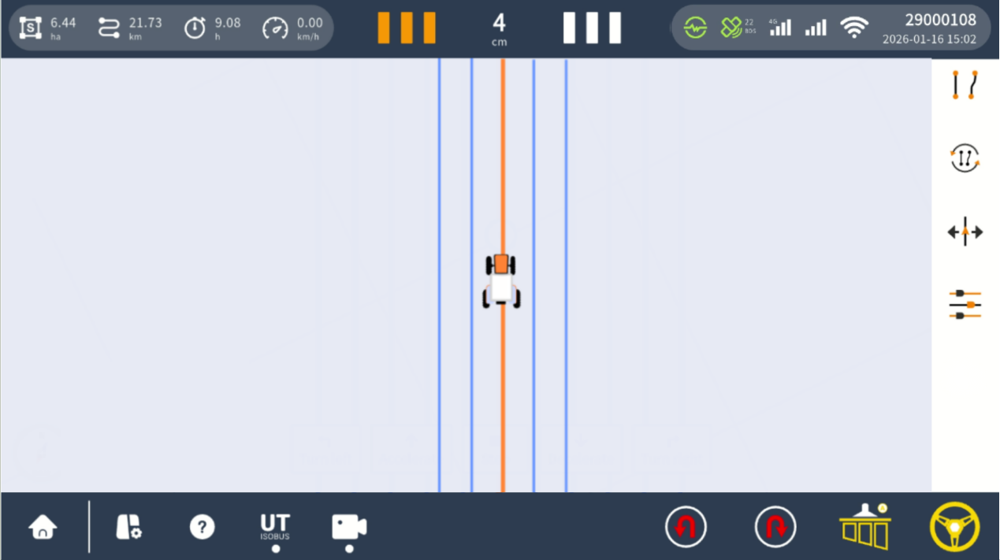

Der **Feldmanager** öffnet sich.

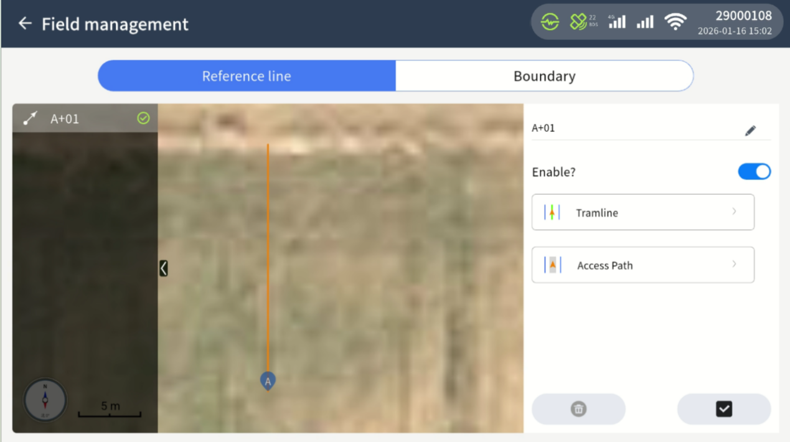

Im Menü oben sehen Sie alle Daten des aktuellen Feldes und können sie bearbeiten.

- **Referenzlinie:** umbenennen, aktivieren/deaktivieren, löschen, laden, Fahrgassen oder Zufahrtswege festlegen.
- **Feldgrenze:** **Vorgewende** an der Feldgrenze anlegen.

## 10. Linienarten

Tippen Sie auf **Navigationswerkzeug** , wählen Sie die gewünschte Referenzlinie  und die Linienart. Mit  geht es weiter.

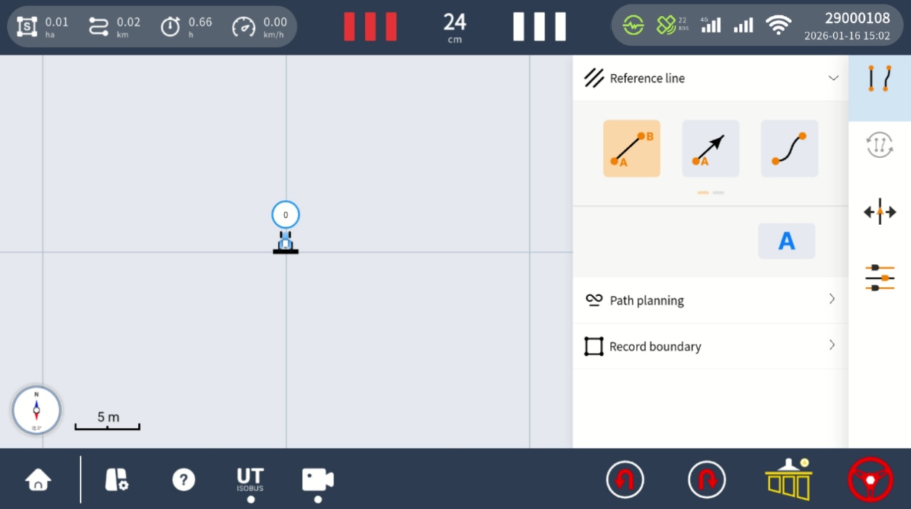

Zur Auswahl stehen u. a. **AB-Linie**, **A+-Linie** und **Kurve**.

### 10.1 AB-Linie

1. Linienart **AB-Linie** wählen.

   

2. Fahrzeug an den Feldanfang fahren, in Arbeitsrichtung ausrichten und auf **Punkt A** tippen.

   

3. Von Hand bis zum Feldende fahren und auf **Punkt B** tippen. Damit ist die AB-Linie fertig. A und B müssen mindestens 5 m auseinander liegen.

   

4. Mit **Bestätigen** (grünes √) abschließen. Mit **Abbrechen** (rotes ×) können Sie jederzeit abbrechen.

    

> 
>
> Fahren Sie beim Anlegen der AB-Linie ohne zu arbeiten (Gerät ausgehoben bzw. ausgeschaltet).
>
> In jedem neuen Feld muss eine eigene AB-Linie angelegt werden. Werden Sie an einem Tag nicht fertig, laden Sie am nächsten Tag einfach das Feld und arbeiten weiter.

### 10.2 A+-Linie

1. Symbol **A+-Linie** antippen.

   

2. Richtung in Grad eingeben. Vorgeschlagen wird automatisch die aktuelle Fahrtrichtung des Fahrzeugs – wenn Sie schon richtig stehen, einfach übernehmen.

   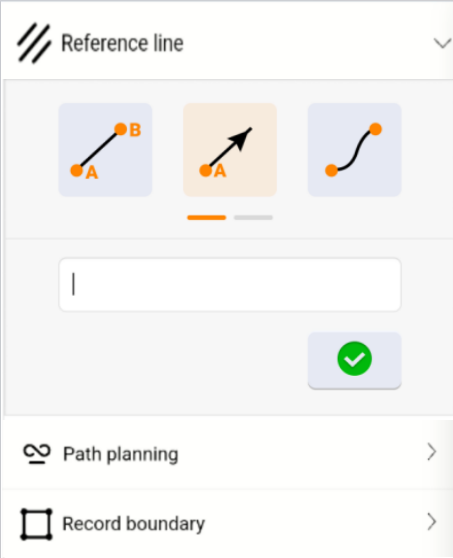

   Richtungen: Nord = 0°, Ost = 90°, Süd = 180°, West = 270°.

3. Mit **Bestätigen** abschließen.

### 10.3 Kurve

Im Modus **Kurve** zeichnen Sie eine Fahrt mit Kurven und Geraden auf. **Vectoris Pro** verwendet sie als Referenzlinie und erzeugt links und rechts davon parallele Führungslinien im Abstand der Arbeitsbreite.

1. Symbol **Kurve** antippen.

   

2. Zum Startpunkt der Aufzeichnung fahren.
3. **Aufzeichnen** tippen.

   

4. Das Terminal markiert den Startpunkt auf der Karte und zeigt die gefahrene Spur als gestrichelte Linie.
   - Für ein gerades Stück **Aufzeichnung pausieren** tippen. Das Stück, das Sie während der Pause fahren, wird als Gerade übernommen.

     

   - Mit **Aufzeichnung fortsetzen** geht die Kurvenaufzeichnung weiter.

     

5. Am Ende der Strecke **Bestätigen** tippen. Mit **Abbrechen** wird die Aufzeichnung jederzeit verworfen.

### 10.4 Kreis

Für Kreise (z. B. unter Kreisberegnung) bietet **Vectoris Pro** drei Methoden. Wählen Sie die, die vor Ort am besten passt.

1. Symbol **Kreis** antippen.

   

2. Auf das Auswahlfeld **Methode** tippen und die Methode aus der Liste wählen.

   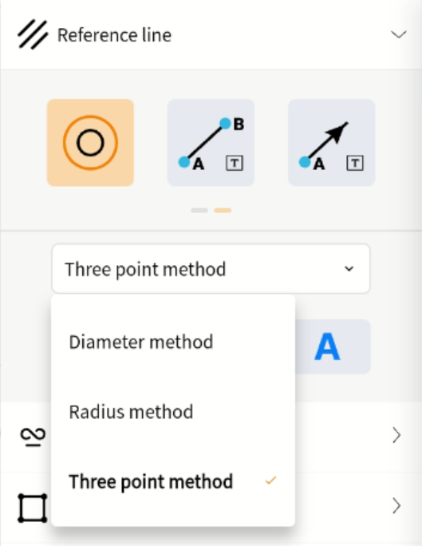

   - **Durchmesser:** Sie fahren einmal quer durch den Kreis; diese Strecke (mindestens 15 m) ist der Durchmesser.

     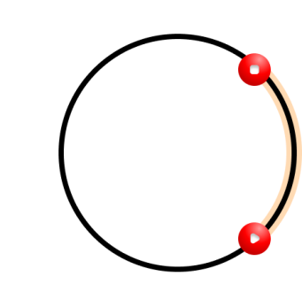

   - **Radius:** Sie setzen den Mittelpunkt O und einen beliebigen Punkt A auf dem Kreisrand.

     

   - **Drei Punkte:** Sie setzen drei verschiedene Punkte A, B und C auf dem Kreisrand.

     

### 10.5 AB-Linie (Koordinaten)

Kennen Sie die Koordinaten von **A** und **B** schon, können Sie die **AB-Linie** auch direkt eingeben.

1. Symbol **AB-Linie (Koordinaten)** antippen.

   

2. Breiten- und Längengrad von **A** und **B** eingeben und mit  anlegen.

   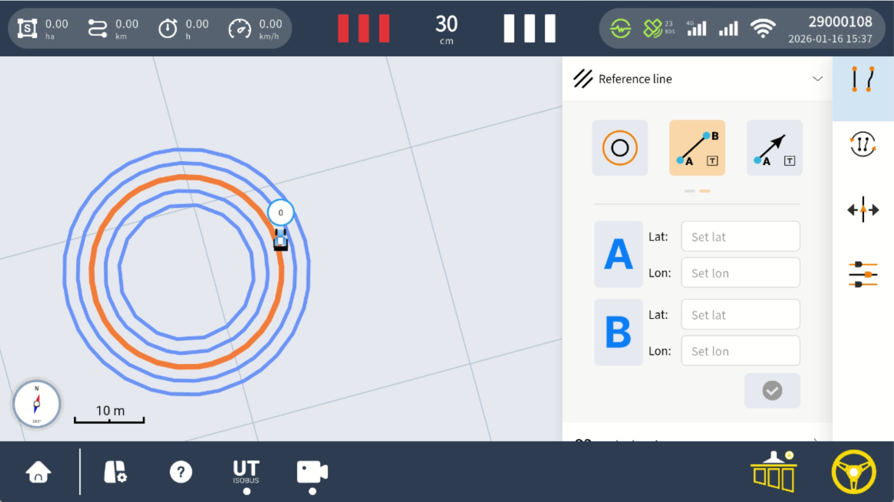

> 
>
> Breite und Länge in Dezimalgrad (z. B. 48.1234567) mit bis zu 7 Nachkommastellen eingeben.

### 10.6 A+-Linie (Koordinaten)

Ebenso lässt sich eine **A+-Linie** aus Koordinaten anlegen.

1. Symbol **A+-Linie (Koordinaten)** antippen.

   

2. Breiten- und Längengrad von **A** und die Richtung eingeben, dann **Bestätigen**.

   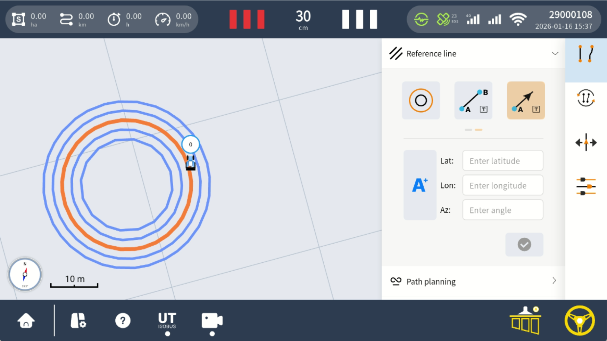

## 11. Automatisches Lenken

| Symbol | Zustand | Funktion |
|:--:|----|----|
|  orange | Bereit zum automatischen Lenken | Antippen startet das Lenken |
|  grün | Lenkt automatisch | Antippen stoppt das Lenken |
|  rot | Automatisches Lenken nicht möglich | Fehler prüfen |

## 12. Feinverschiebung

Um die Führungslinie fein zu verschieben, tippen Sie rechts im Arbeitsbildschirm auf **Feinverschiebung**.

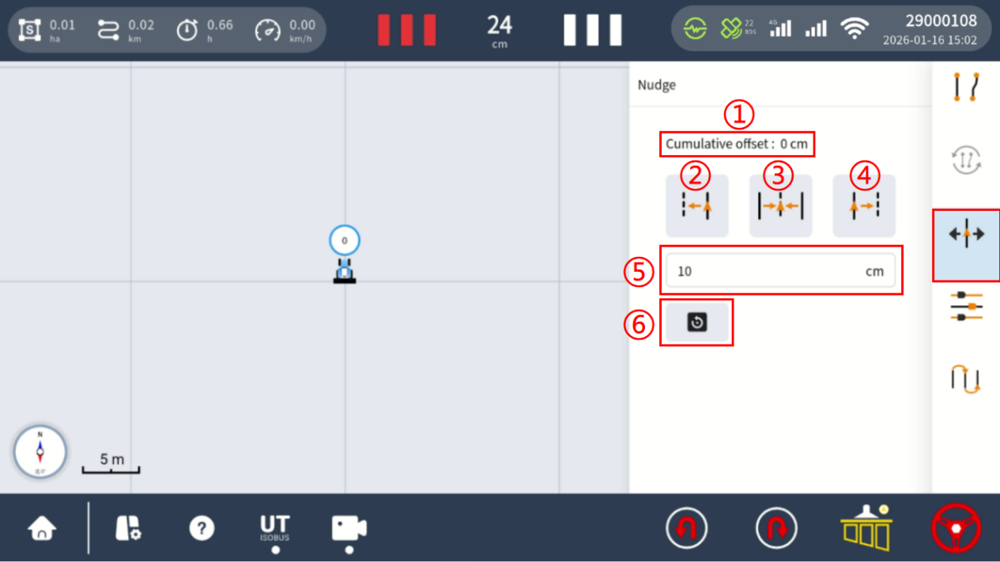

| Nr. | Name | Beschreibung |
|:--:|----|----|
| 1 | Gesamtversatz | Verschiebung gegenüber der ursprünglichen Linie (0). „–“ = nach links, „+“ = nach rechts. |
| 2 | Nach links | Linie nach links verschieben |
| 3 | Hierher | Linie auf die aktuelle Fahrzeugposition legen |
| 4 | Nach rechts | Linie nach rechts verschieben |
| 5 | Wert | Gewünschte Verschiebung eingeben (in cm) |
| 6 | Zurücksetzen | Linie auf die ursprüngliche Lage zurücksetzen |

> 
>
> Wird der Arbeitsbildschirm mit einer neuen Aufgabe geöffnet, werden alle Verschiebungen zurückgesetzt.

## 13. Allgemeine Funktionen

### 13.1 Statusleiste

Die Statusleiste zeigt laufend die aktuellen Arbeitsdaten. Tippen Sie während der Arbeit (mit oder ohne Lenkautomatik) auf den Bereich oben links, öffnet sich ein Fenster mit Details. Ein weiteres Tippen dort oder auf eine freie Stelle schließt es.

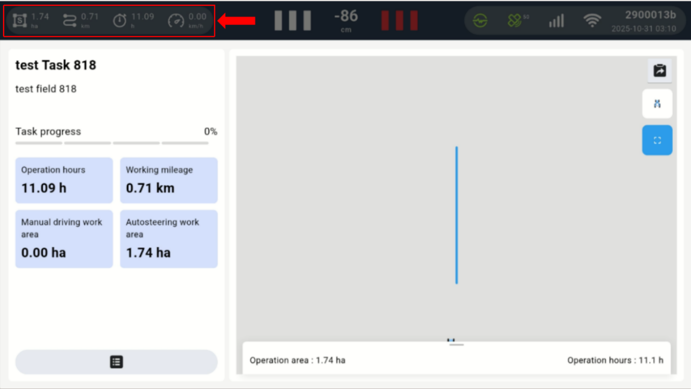

| Nr. | Wert | Beschreibung |
|:--:|----|----|
| 1 | Aufgabe | Name der aktuellen Aufgabe |
| 2 | Einsatzzeit | Zeit mit eingeschalteter Lenkautomatik; bei ausgeschalteter Lenkautomatik zählt sie nicht weiter. Ist die Spuraufzeichnung auf „manuell“ gestellt, zählt auch die Zeit, die von Hand gelenkt wird. |
| 3 | Strecke | Strecke mit eingeschalteter Lenkautomatik; bei ausgeschalteter Lenkautomatik zählt sie nicht weiter. Ist die Spuraufzeichnung auf „manuell“ gestellt, zählt auch die von Hand gelenkte Strecke. |
| 4 | Fläche manuell | Fläche, die von Hand gelenkt bearbeitet wurde |
| 5 | Fläche automatisch | Fläche, die mit Lenkautomatik bearbeitet wurde |
| 6 | Aufgabenliste | Öffnet die Aufgabenliste zum Ansehen und Auswählen |

### 13.2 Einstellungen

Tippen Sie oben rechts auf einem beliebigen Bildschirm auf den **Statusbereich**, um das Menü **Einstellungen** zu öffnen. Erneutes Tippen schließt es.

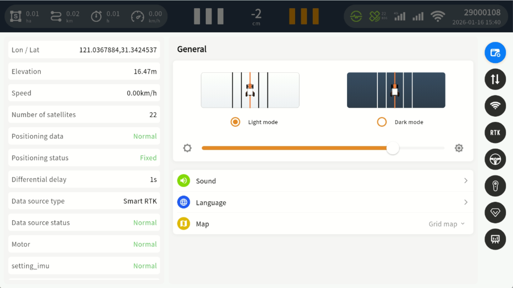

| Symbol | Beschreibung |
|:--:|----|
|  | **Allgemein** – Design (hell/dunkel), Helligkeit, Lautstärke, Warnton, Einheiten, Satellitenkarte |
|  | **WLAN** – WLAN-Netze verbinden und einstellen |
|  | **Mobilfunk** – SIM-Karte anzeigen, Mobilfunknetz einstellen |
|  | **RTK** – Korrekturdatenquelle einstellen und verwalten |
|  | **Navigation** – Navigationsmodus und -parameter |
|  | **Externe Geräte** – Zubehör wie 360°-Kameras oder kabelgebundene Joysticks |
|  | **Lizenzen** – Basisdienste, SBAS und kostenpflichtige Softwarefunktionen |
|  | **Demomodus** – Vorführmodus ein/aus und einstellen |

### 13.3 Anschluss einstellen

1. Auf dem Hauptbildschirm die **Anbaugerätekarte** antippen und das Gerät wählen, dessen **Anschluss** (Spurabstand) korrigiert werden soll.

   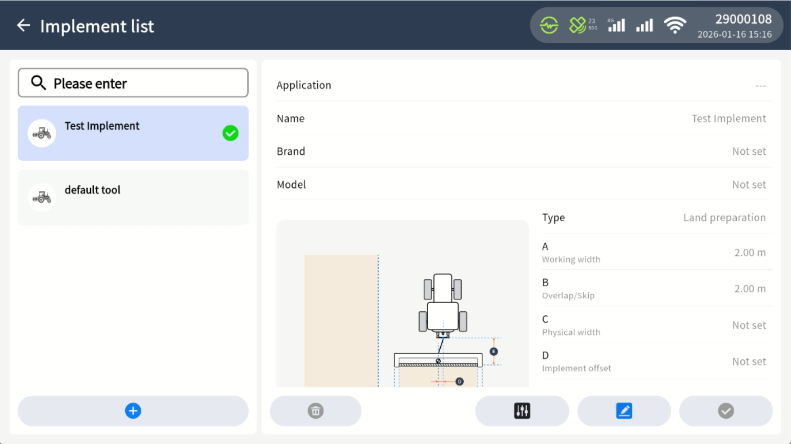

2. **Maße** öffnen; dort lassen sich die Werte von Hand anpassen.

   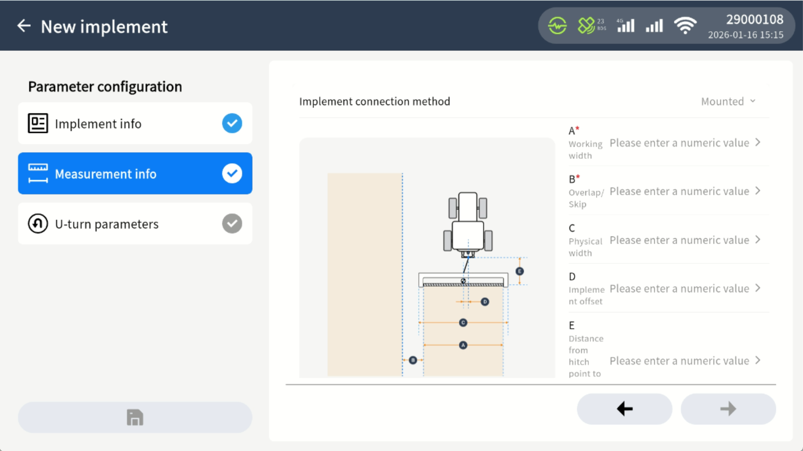

3. **Drei-Bahnen-Methode:** Fahren Sie mit dem Traktor drei Bahnen hin und zurück. Messen Sie danach am Feld den Abstand zur linken und zur rechten Nachbarspur und stellen Sie fest, auf welcher Seite die Abweichung liegt. Geben Sie den gemessenen **Spurabstand** ein und tippen Sie auf **Bestätigen**.

> 
>
> Vorher müssen die Gerätemaße stimmen. Linker und rechter Abstand zusammen müssen **doppelt so groß wie der Soll-Spurabstand** sein.
>
> *Beispiel:* links 62 cm, rechts 70 cm, Soll 66 cm: 70 + 62 = 66 × 2 – die Gerätemaße stimmen.

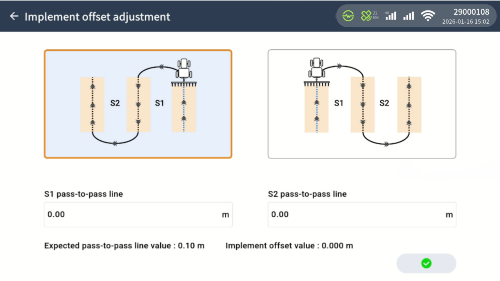

### 13.4 Lenkparameter

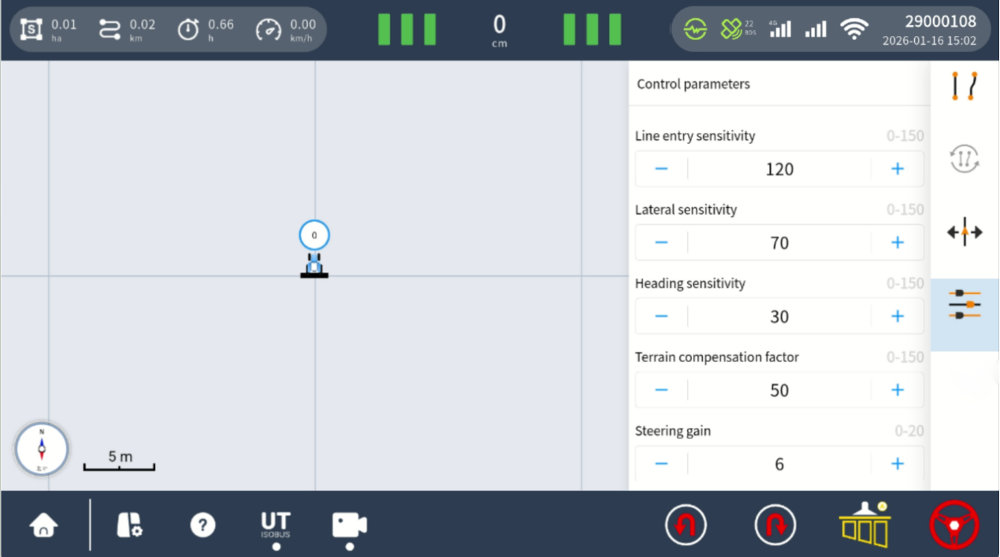

- **Empfindlichkeit Linieneinfahrt** – wie schnell das Fahrzeug auf die Führungslinie einschwenkt.
- **Seitliche Empfindlichkeit** – wie früh das System bei seitlicher Abweichung gegenlenkt.
- **Richtungsempfindlichkeit** – wie stark das System bei Richtungsabweichung lenkt.
- **Geländeausgleich** – wie stark Hang und Unebenheiten ausgeglichen werden.
- **Lenkverstärkung** – wie schnell und oft das Lenkrad nachkorrigiert.

### 13.5 Versionsverwaltung

Tippen Sie auf dem Hauptbildschirm auf **Versionsverwaltung**.

Wählen Sie unten rechts die Art des Updates:

- **Lokales Update:** USB-Stick anstecken und die gewünschte Version installieren.
- **Online-Update:** Das System sucht im Internet nach einer neuen Version und bietet sie zum Herunterladen und Installieren an.

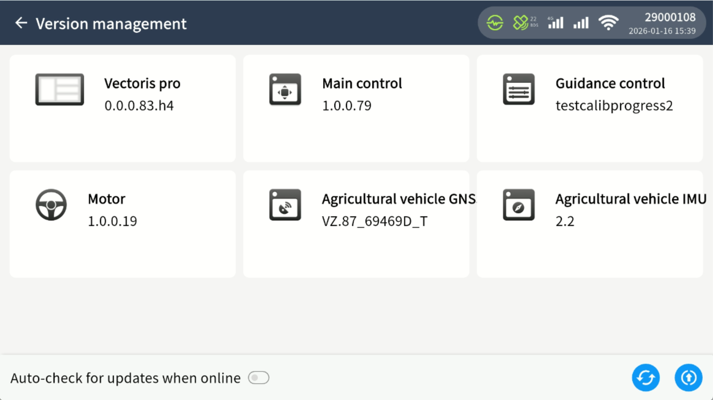

# V. HD Digital Ag

Auf der Plattform legen Sie Feldgrenzen, Anbaugeräte, Betriebsmittel, Applikationskarten und Aufgaben an. Sie werden automatisch mit den HD-Lenksystemen, der HD-Agrardrohne und der HD-Ag-App abgeglichen, sodass überall dieselben Daten vorliegen.

- HD-Ag-Plattform: [www.huidaag.com](http://www.huidaag.com)
- HD-Ag-App:

# VI. Häufige Probleme

## 1. Statusanzeigen

| Anzeige | Status | Bedeutung |
|----|----|----|
| Positionsstatus | Fixed | Normal (RTK fix) |
| | Floating | Satellitenempfang schwach oder zu wenige Satelliten |
| | Pseudorange | Keine Korrekturdaten von der Basisstation |
| | Single Point | Nur GPS ohne Korrekturdaten (ungenau) |
| | Invalid | Kein Satellitenempfang |
| WAS (Lenkwinkel) | Not connected | Anschluss des Hauptkabelbaums prüfen |
| | Connected | Normal |
| Heading/Lenkwinkel | Uninitialized | Kann nach längerem Stillstand auftreten. Fahrzeug starten und mit mehr als 1,6 km/h vorwärts fahren – dann initialisiert sich das System neu. |

## 2. Fehlersuche

| Fehlerbild | Ursache | Abhilfe |
|----|----|----|
| Terminal startet nicht | Sicherung defekt | Sicherung ersetzen |
| Eingeschaltet, aber Lenkrad bewegt sich nicht | Motor defekt | Motor ersetzen |
| Bildschirm schwarz oder flackert | Terminal defekt | Terminal ersetzen |
| | Terminal-Kabelbaum beschädigt | Terminal-Kabelbaum ersetzen |
| | Hauptkabelbaum des Empfängers ohne Strom | Hauptkabelbaum ersetzen |
| | Batterie leer / Stromkabel locker | Batterie laden oder Stromanschluss festziehen |
| Lenkautomatik schaltet unerwartet ab | Wackelkontakt im Kabelbaum | Steckverbindungen prüfen und sichern |

# VII. Wartung

- Warten Sie das System wie hier beschrieben, damit es störungsfrei läuft und lange hält.
- Zerlegen oder verändern Sie die Hauptkomponenten nicht selbst. Wenden Sie sich bei Problemen an Ihren Händler bzw. Kundendienst.
- Bedienen Sie das System nur so, wie es in dieser Anleitung beschrieben ist.
- Prüfen Sie wöchentlich alle Schrauben, Kabel und Stecker, z. B. die Befestigung von **Steuergerät** und **Winkelsensor** sowie die **Datenkabelstecker**. Ziehen Sie Lockeres sofort fest und lassen Sie Beschädigtes reparieren.

**Wartung des Lenkmotors:**

- Halten Sie den Lenkmotor sauber. Staub und Erde dürfen sich nicht dauerhaft darauf ansammeln.
- Decken Sie den Motor im Betrieb nicht mit Tüchern, Hüllen o. Ä. ab, damit er gekühlt wird.
- Prüfen Sie vor jeder Saison, ob sich die Mechanik leicht bewegt, die Kupplung rund läuft und das Getriebe frei dreht. Klemmt etwas, beheben Sie die Ursache vor dem Einsatz.

# VIII. Kabelplan

# IX. Garantie (Herstellerregelung Huida, China)

> **Hinweis:** Dieses Kapitel gibt die Garantieregelung des Herstellers für China („Drei Garantien“: Reparatur, Austausch, Rückgabe) wieder. In Deutschland und Österreich gelten die gesetzlichen Gewährleistungsrechte sowie die Garantiebedingungen Ihres Händlers.

Die folgenden Regeln sollen die Rechte der Kunden schützen und den Kundendienst des Herstellers verbindlich festlegen.

Jedem System liegt ein Garantieheft bei. Füllen Sie die **Registrierungskarte** gleich nach dem Kauf aus.

Grundlage sind die einschlägigen Gesetze, etwa das *Produktqualitätsgesetz* und das *Verbraucherschutzgesetz der Volksrepublik China*.

Die Garantiezeit beginnt mit dem Rechnungsdatum. Reparaturzeiten und Wartezeiten wegen fehlender Ersatzteile werden nicht auf die Garantiezeit angerechnet.

a. Wird innerhalb von **fünf (5) Tagen** nach dem Kauf ein Qualitätsmangel festgestellt, kann der Käufer **Rückerstattung oder Austausch** wählen.  
b. Bei einem Austauschgerät beginnt die Garantiezeit mit dem Austauschdatum neu.  
c. Funktioniert das Produkt nach **zwei Reparaturen** innerhalb der Garantiezeit immer noch nicht, werden die defekten **Systemkomponenten** durch neue ersetzt.

Für eine Garantieleistung bringen Sie dieses Heft und die Rechnung zu einer autorisierten Servicestelle und füllen das **Reparaturprotokoll** aus.

a. In Regionen ohne Servicenetz des Herstellers ist der **örtliche Händler** zuständig.  
b. Gibt es keinen Händler, kann sich der Servicetechniker mit dem **Reparaturprotokoll** direkt an den **Hersteller** wenden.

Routinewartung, Pflege, Einstellung und Prüfung laut **Produkthandbuch** fallen **nicht** unter die Garantie.

Die Garantiezeit für das **komplette System** beträgt **ein (1) Jahr** und umfasst alle Hardwarekomponenten.

**Ausschlüsse**

In folgenden Fällen besteht kein Garantieanspruch; eine **kostenpflichtige Reparatur** ist möglich:

a. Vorzeitiger Verschleiß oder Defekt durch **unsachgemäße Nutzung, Wartung oder Pflege**, z. B. Betrieb außerhalb der im Handbuch genannten Bedingungen, Nichtbeachtung der Anleitung oder eigenmächtiges Ändern von Spannungsparametern.  
b. Defekte, weil Komponenten **eigenmächtig verändert, verstellt oder zerlegt** wurden, obwohl das Handbuch dies verbietet.  
c. **Garantieschein** und **Kaufbeleg** fehlen, oder es ist nicht nachweisbar, dass die Garantiezeit noch läuft.  
d. Modell oder Ausführung auf **Garantieschein/Rechnung** passen nicht zum Produkt oder wurden verändert.  
e. Nach dem Fehler wurde **eigenmächtig am Gerät gearbeitet** oder der Originalzustand nicht erhalten, sodass die Ursache bei der Prüfung nicht mehr feststellbar ist.  
f. Schäden durch **Fehlbedienung**, z. B. Verlassen der Kabine bei eingeschalteter Lenkautomatik.  
g. Schäden durch **höhere Gewalt** (z. B. Naturkatastrophen).

> 
>
> Bei Widersprüchen zwischen diesen Regeln und gesetzlichen Vorschriften gelten die **gesetzlichen Vorschriften**.

## Garantieschein

| | | | |
|----|----|----|----|
| **Produkt** | Produktname | Automatisches Lenksystem | |
| | Modell | | Terminalnummer |
| **Kunde** | Name | | Anschrift |
| | Telefon | | PLZ |
| **Händler** | Firma | | Anschrift |
| | Telefon | | PLZ |
| | Verkaufsdatum | | Preis |
| | Rechnungsnummer | | Händlerstempel |
| **Hersteller** | Firma | | Anschrift |
| | PLZ | | |
