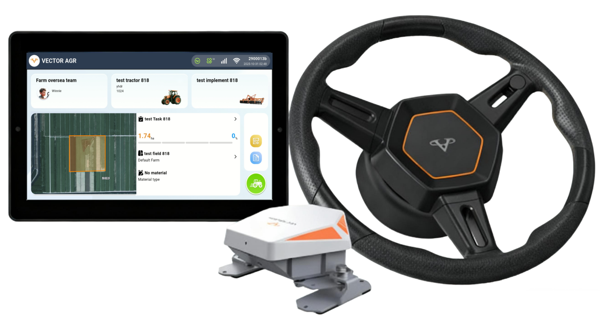

# I. Disclaimer

## 1. Disclaimer

This document provides information about the products of Heilongjiang Huida Technology Co., Ltd. This document does not, by implication, estoppel, or any other form, transfer any patents, trademarks, copyrights, ownership rights, or any rights or licenses thereunder of this company or any third party.

Except for the responsibilities stated by Huida Company in the sales terms and conditions of its products, this company assumes no other responsibilities whatsoever. Moreover, the company makes no express or implied warranties regarding the sale or use of its products, including warranties of fitness for a particular purpose, merchantability, or liability for infringement of any patents, copyrights, or other intellectual property rights. The company may modify product specifications and product descriptions at any time without prior notice.

All rights reserved ©2019-2025, Heilongjiang Huida Technology Co., Ltd.

## 2. Technology and Services

If the content you need cannot be found in this operation manual, please contact the relevant project installation technicians.

Users can also contact us by calling Huida's national customer service hotline: 400-888-0787.

The current interface function display is a test version. Please refer to the actual interface functions for the real situation.

# II. Product Usage Instructions

## 1. Product Usage Instructions

- Carefully read all user materials provided with this product before use to understand the product's usage methods and precautions.
- Do not disassemble the equipment without permission to avoid safety hazards. If needed, contact professionals. When professionals disassemble the equipment, turn off the power in advance and never disassemble it while powered on.
- Do not connect this equipment unless strictly following the requirements in the manual. Avoid equipment damage and potential safety hazards caused by incorrect connections.
- When supplying power to this product (auto driving system), pay attention to the equipment's power supply requirements (power supply voltage must be between 9 and 35 V).
- Check each wire harness of the product. If there is damage, replace it in time to avoid affecting the usage effect or causing potential safety hazards.
- Do not disassemble the housing of any component of this product yourself; otherwise, repairs will not be provided.
- This product does not have an active obstacle avoidance function. Therefore, personnel must be present when the auto driving system is operating to monitor surrounding safety in real time.
- The auto driving system cannot control the vehicle's speed. Operators must manually adjust the vehicle speed within a safe and reasonable range.
- When the auto driving system is testing or calibrating, it will take over control of the vehicle's steering system. The vehicle's steering wheel, wheels, or other body parts may move unpredictably. When starting the vehicle or activating the auto driving system, ensure surrounding safety to prevent personal injury or property damage.
- Vehicles equipped with our company's auto driving system are not allowed to activate auto driving on public roads or in public places.
- Before each use, check whether all components on the equipment are damaged or abnormal. Only when all parts of the equipment are in good working condition can you continue to use this product. If abnormalities or damaged parts are found during inspection, handle them in time or contact after-sales personnel.
- Vehicle accidents caused by illegal operations during auto driving operations have no relation to Heilongjiang Huida Technology Co., Ltd.

## 2. Safety Tips

| | |
|:--:|----|
|  | When the equipment's auto driving function is activated, the driver is strictly prohibited from leaving the cab. |
|  | The auto driving system is strictly forbidden to be used during non-operating hours or in non-operating areas. |
|  | Please use the equipment strictly in accordance with the instruction manual; random modification of software parameters is prohibited. |
|  | When the equipment is not used for a long time, disconnect the power cord to prevent battery drain. |
|  | When using the equipment, keep the devices in the cab waterproof. Protective measures for the equipment must be taken when cleaning the vehicle, etc. |
|  | The auto driving system cannot control the vehicle speed, so the operator must manually adjust the vehicle speed to ensure safe driving. |
|  | Unauthorized disassembly of the equipment is strictly prohibited; otherwise, warranty service will not be provided. |

# III. Product Introduction

## 1. Product Overview

The Auto Steering System is a core system for intelligent agricultural equipment independently developed and manufactured by **Huida Technology**, leveraging the company's proprietary core technologies.

The HD818 Auto Steering System with Navigation is an autopilot system independently developed and produced by Huida Tech; a high-torque motor is used to control the steering wheel. It is suitable for tractors, transplanters, sprayers, crawler tractors and other agricultural machinery.

Validated through extensive practical applications, the system provides a complete set of supporting components, making it fully compatible with all steering-wheel-type agricultural machinery. In its design, the specific characteristics of agricultural production and operating environments have been fully considered, effectively solving real-world problems encountered during agricultural operations.

- Effectively improves operation accuracy, meets standardized agricultural requirements, and enhances the quality of agricultural products.
- Transforms manual operation from "less overlap and no omission" to automated "no overlap and precise operation", significantly improving operational efficiency.
- Extends the working time of agricultural machinery – machines can continue operating while operators take breaks, and fieldwork can also be performed at night.
- Simple operation reduces driver workload and lowers the skill requirements for operators.

## 2. Main Components

| Device Name | Picture |
|:--:|----|
| GNSS Antenna | 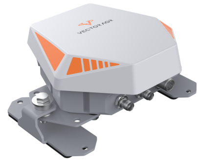 |
| Display Terminal | 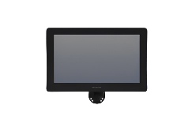 |
| Electronic Steering Motor | 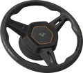 |
| Gyroscope | 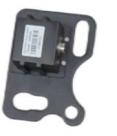 |

# IV. Product Usage

## 1. Display Terminal

The interface illustration is as follows:

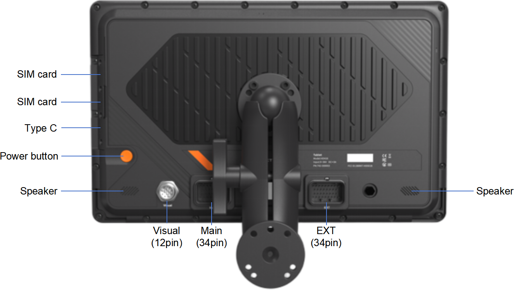

## 2. Power On/Off

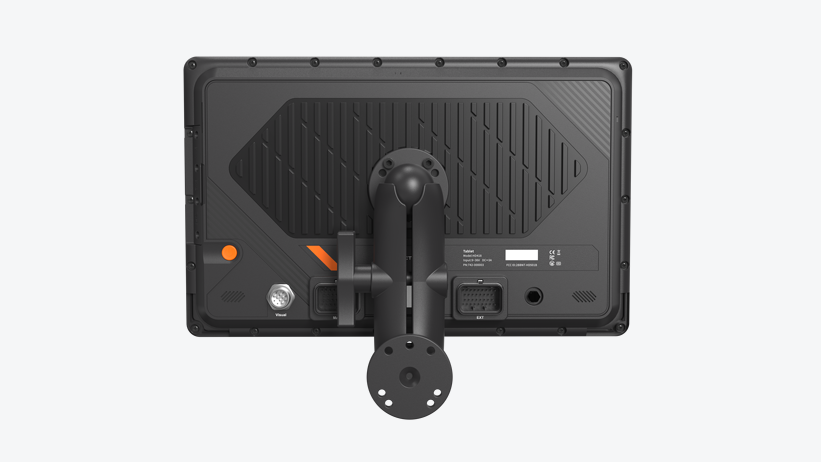

Long press the power button on the display terminal for 3 seconds to turn on the navigation system.

## 3. Account Login

Log in to your account to use **Vectoris Pro**. The system manages operator information and production data through individual user accounts and provides platform-level data services.

When not logged in, all production-related cards on the main screen are displayed in gray. Tap the **Login Card** in the upper-left corner of the main screen to access your account.

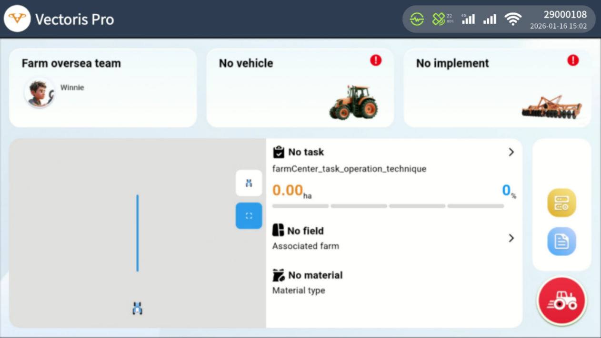

Two login methods are available:

**QR Code Login** – scan the QR code with the **Huida Ag App**; suitable for **personal or regular members**.

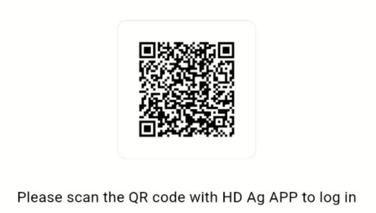

**Authorization Code Login** – enter the authorization code issued by the organization platform; suitable for **temporary members**.

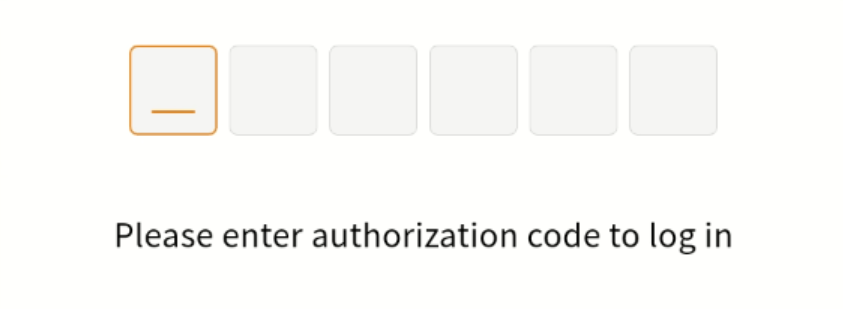

## 4. Production Cards

Production cards include **vehicles**, **implements**, **tasks**, **fields** and **agricultural materials**. They allow you to clearly view the current configuration of production resources and understand the work to be performed after entering the main page.

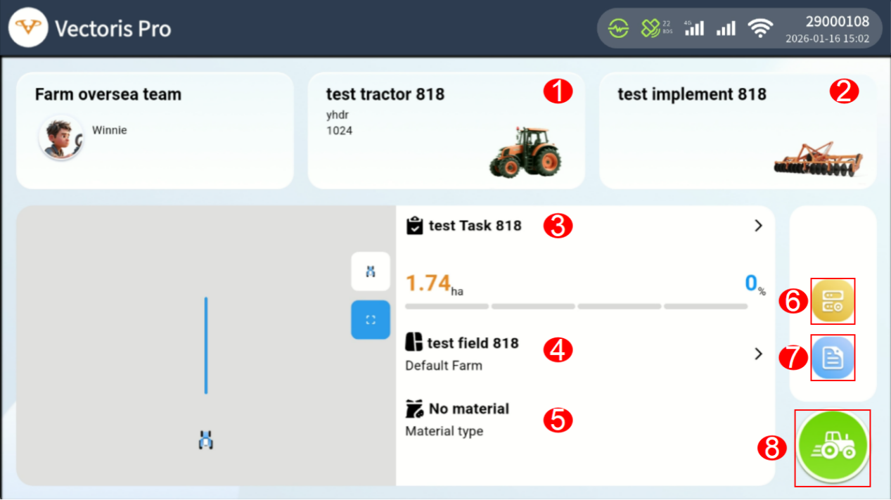

1. **Vehicle Card:** In the normal state, this card displays the basic identification information of the vehicle currently selected in the system. Tap the card to enter the **Vehicle Management List**. If no vehicle is configured, the card displays a  prompt. In this case you cannot proceed to the **Workbench**, because a vehicle is required.

   

2. **Implement Card:** In the normal state, this card displays the basic identification information of the implement currently selected in the system. Tap the card to enter the **Implement Management List**. If no implement is configured or the selected implement type does not match the task type, a prompt appears and you cannot access the **Workbench**.

   

3. **Task Card:** In the normal state, this card displays a summary of the current task. Tap the card to open the **Task Management List**. A task is required to enter the **Workbench**; if no task is set, you cannot proceed.

4. **Field Card:** In the normal state, this card displays the field associated with the current task. Tap the card to open the **Field Management List**. When creating a task in **Vectoris Pro**, a field must be assigned to the task. The left side of the Field Card shows a satellite view of the field.

5. **Agricultural Material Card:** In the normal state, this card displays the agricultural material configuration linked to the current implement. Agricultural material does not have to be configured, but you can tap the card to open the **Agricultural Material Management List**.

6. **Version Management Icon:** Tap the button to enter the version management interface. You can view the version numbers of all connected devices and select the upgrade method.

7. **Data Transmission Icon:** Tap the icon to enter the data manager, which offers data exchange with other terminals or external storage devices for different scenarios.

8. **Workbench Icon:** Once the home screen is configured correctly, tap the **Workbench** icon to enter the workbench interface.

## 5. Vehicle List

Select the Vehicle Card to open the vehicle selection interface.

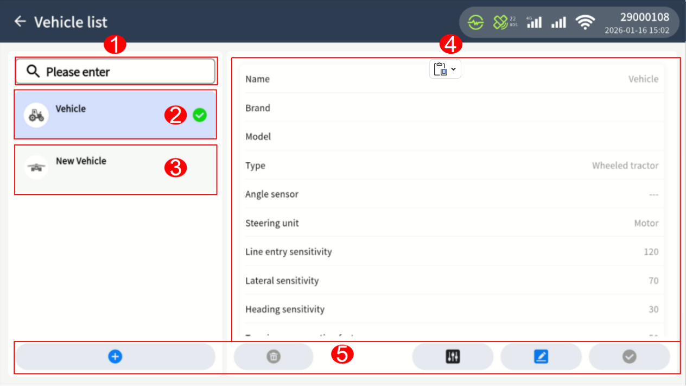

1. Quickly search for **vehicles** by entering keywords.
2. This icon indicates **the vehicle currently activated by the system**.
3. Select the **vehicle** to be operated. Tap an item in the list to select it.
4. Displays a summary of the selected **vehicle information**. Scroll down to view more details.
5. Manage the selected **vehicle**: create, delete, edit, activate or calibrate it.

### 5.1 Add New Vehicle

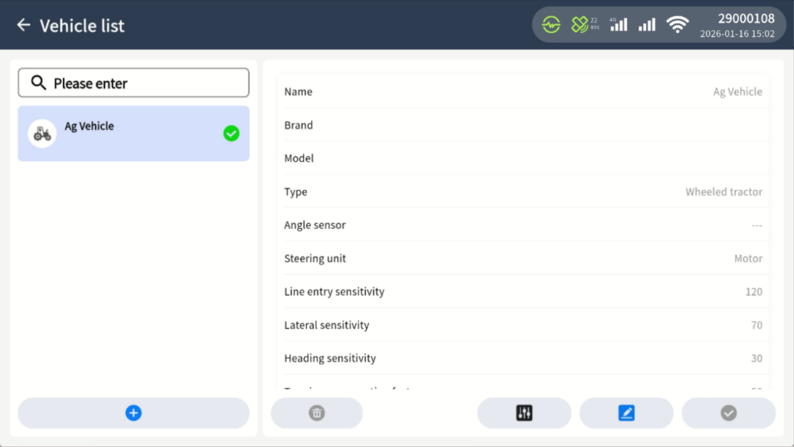

Tap the  button to add a new vehicle.

#### 5.1.1 Vehicle Information

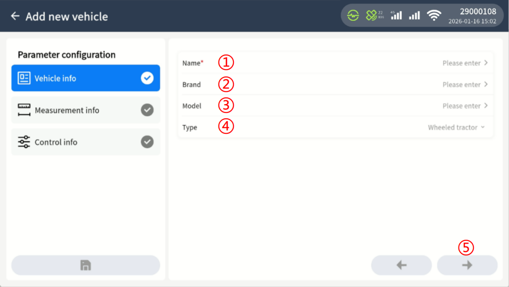

| No. | Function | Description |
|:--:|----|----|
| 1 | Name | Enter the name of the vehicle. (Required) |
| 2 | Brand | Enter the brand of the vehicle. |
| 3 | Model | Enter the model of the vehicle. |
| 4 | Type | Select the vehicle type: wheeled tractor / tracked tractor / articulated tractor / rice transplanter / harvester / self-propelled sprayer |
| 5 | → | Operation button. Tap to go to **Measurement Information**. |

#### 5.1.2 Measurement Information

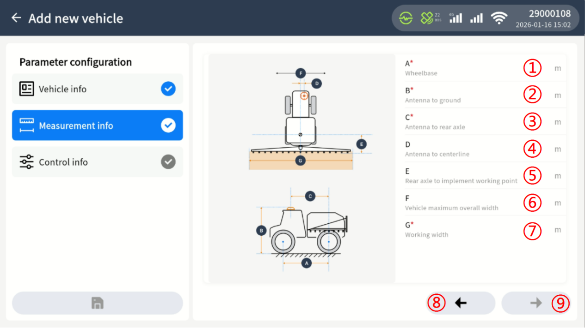

| No. | Function | Description |
|:--:|----|----|
| 1 | Wheelbase | Straight-line distance between front and rear wheel centers, unit: m (Required) |
| 2 | Antenna to ground | Straight-line distance from the top of the antenna to the ground, unit: m (Required) |
| 3 | Antenna to rear axle | Horizontal distance from the antenna to the rear axle, unit: m (Required) |
| 4 | Antenna to centerline | Distance from the antenna to the vehicle centerline, unit: m |
| 5 | Rear axle to implement working point | Distance from the rear axle to the three-point hitch, unit: m |
| 6 | Vehicle maximum overall width | Distance from the rear axle to the drawbar point, unit: m |
| 7 | Working width | Distance between the leftmost and rightmost working points of the implement, unit: m (Required) |
| 8 |  | Operation button. Tap to go back to **Vehicle Information**. |
| 9 |  | Operation button. Tap to go to **Control Information**. |

#### 5.1.3 Control Information

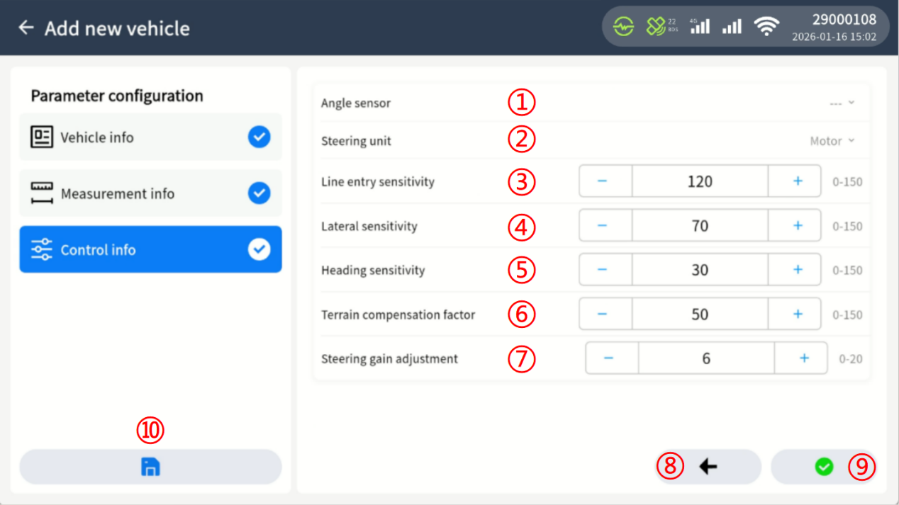

| No. | Function | Description |
|:--:|----|----|
| 1 | Angle sensor | Select the angle sensor type: … / label side up / label side down |
| 2 | Steering unit | Select the steering unit type: motor / hydraulic valve / Steer Ready CAN |
| 3 | Line entry sensitivity | Responsiveness during the line entry phase |
| 4 | Lateral sensitivity | Timing of steering wheel corrections |
| 5 | Heading sensitivity | Steering wheel oscillation angle |
| 6 | Terrain compensation factor | Weight of the system compensation for significant terrain changes |
| 7 | Steering gain | Frequency of steering wheel oscillations |
| 8 |  | Operation button. Tap to go back to **Measurement Information**. |
| 9 | √ | Operation button. Tap to activate this vehicle and start calibration. |
| 10 | Save | Operation button. Tap to save the current configuration. |

> 
>
> You can temporarily skip calibration to finish creating the vehicle before you are fully prepared. However, Vectoris Pro does not allow an uncalibrated vehicle to be activated for the workbench.
>
> When you later select this vehicle from the list, you will be asked again whether to calibrate; the vehicle is activated only after calibration is completed.

## 6. Implement List

Select the Implement Card to open the implement list.

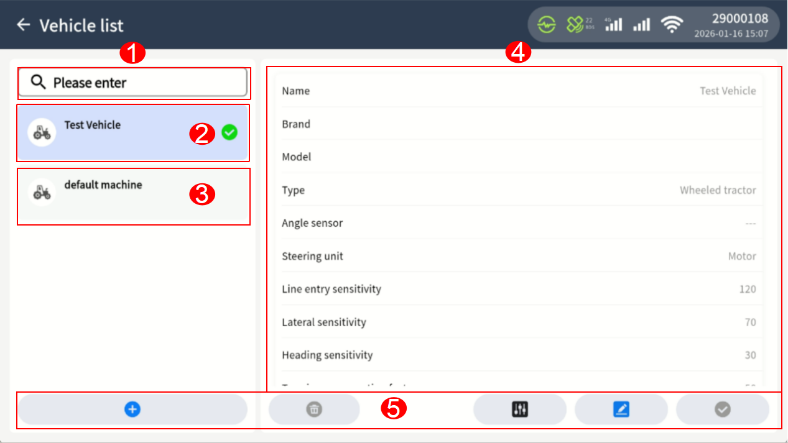

1. Quickly search for **implements** by entering keywords.
2. This icon indicates **the implement currently activated by the system**.
3. Select the **implement** to be used. Tap an item in the list to select it.
4. Displays a summary of the selected **implement information**. Scroll down to view more details.
5. Manage the selected **implement**: create, delete, edit or activate it.

### 6.1 Create a New Implement

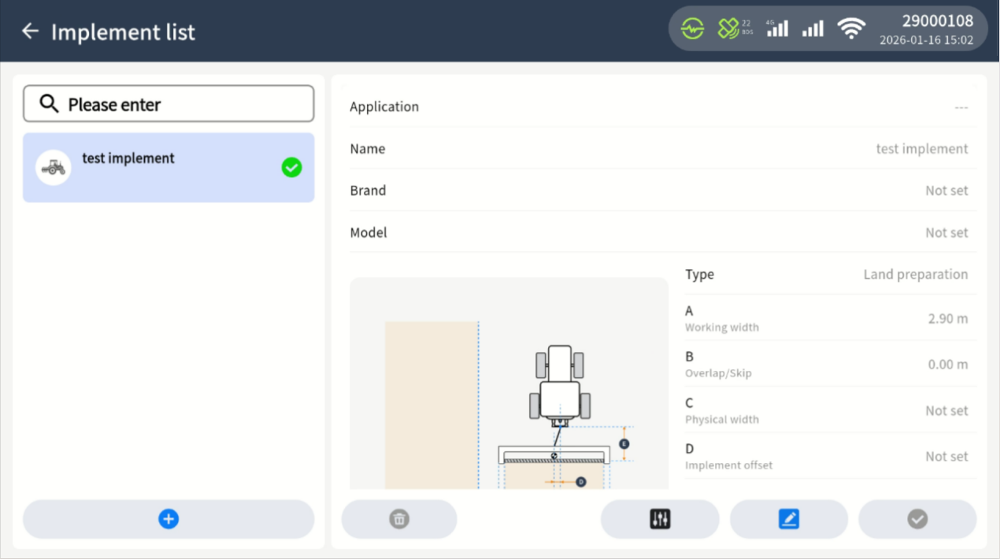

Tap the  button to enter the implement information and measurement information.

#### 6.1.1 Implement Information

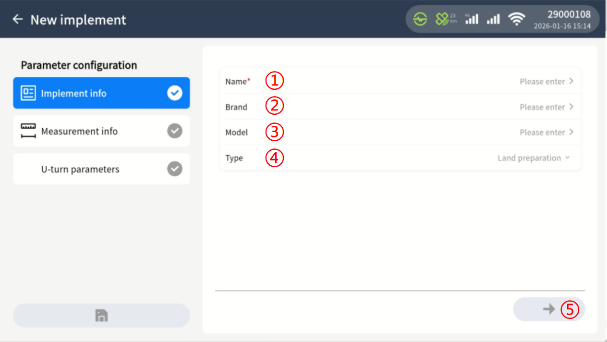

| No. | Function | Description |
|:--:|----|----|
| 1 | Name | Enter the name of the implement. |
| 2 | Brand | Enter the brand of the implement. |
| 3 | Model | Enter the model of the implement. |
| 4 | Type | Select the implement type: tillage / seeding / inter-row cultivation / crop protection / fertilization / harvesting / vegetable transplanting / irrigation / transport / land leveler / other |
| 5 | → | Operation button. Tap to go to **Measurement Information**. |

#### 6.1.2 Measurement Information

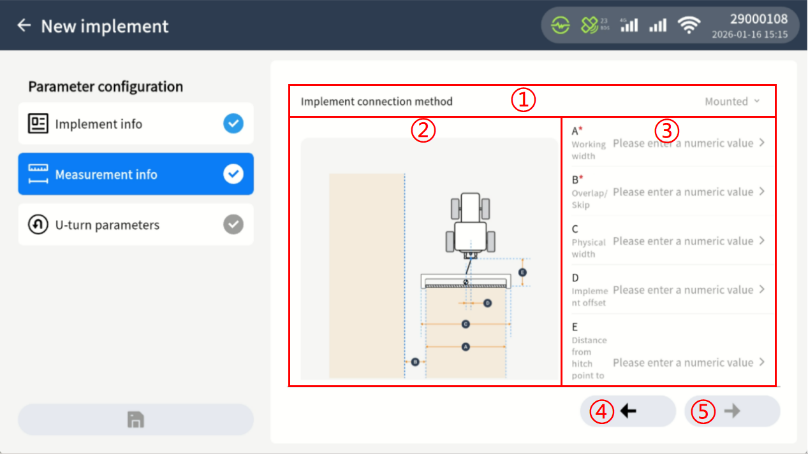

Select the **connection method** that matches the vehicle and enter the following parameters from actual measurements: **working width**, **overlap / skip**, **offset**, **physical width** and **distance from the hitch point to the working point**.

| No. | Function | Description |
|:--:|----|----|
| 1 | Connection method | Select according to the connection type: towed / mounted. |
| 2 | Implement parameter diagram | Diagram showing the implement parameters for accurate measurement. |
| 3 | Implement parameters | A working width, B overlap / skip, C physical width, D implement offset, E distance from hitch point to working point. Units follow the selected unit system (m by default). |
| 4 | ← | Operation button. Tap to return to **Implement Information**. |
| 5 | → | Operation button. Tap to go to **U-turn Parameters**. |

##### 6.1.2.1 Connection Method

Select according to the connection type of the vehicle: **towed / mounted**.

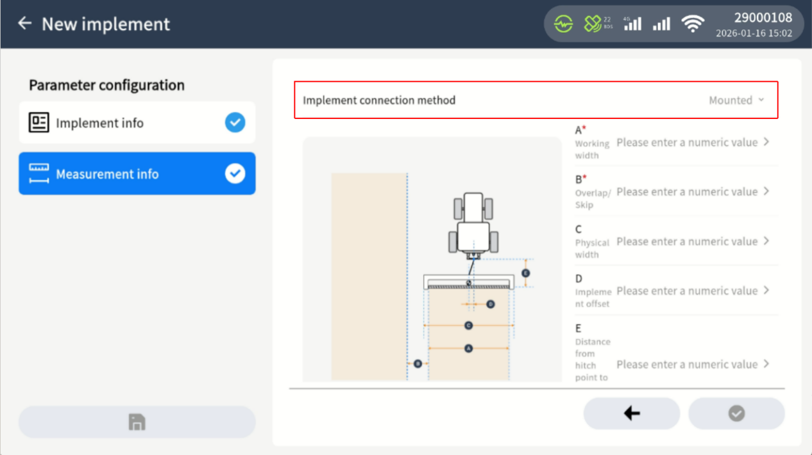

##### 6.1.2.2 Implement Width

As shown in the figure, measure the actual working width of the implement before operation: the distance between the leftmost and rightmost working points of the implement's working track. Average several measurements and make sure the data is accurate – otherwise the pass-to-pass line width will be inaccurate. Enter the measured implement width.

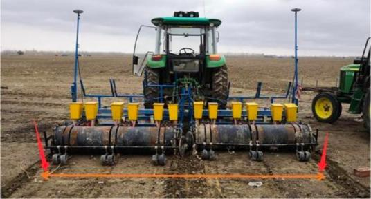

##### 6.1.2.3 Pass-to-Pass Line Width

- **Definition:** the distance between two adjacent working passes of the vehicle.
- **Left pass-to-pass line:** the pass on the driver's left-hand side.
- **Right pass-to-pass line:** the pass on the driver's right-hand side.
- **Overlap:** the overlapping area between working passes.
- **Skip:** the unworked area between passes.

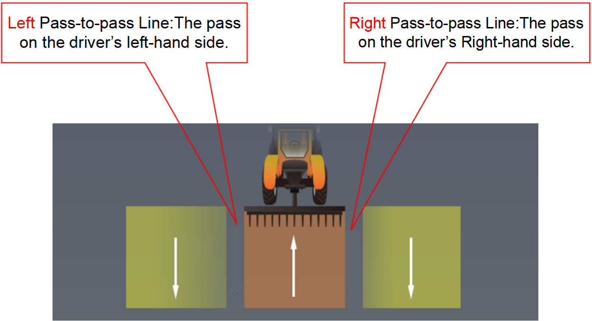

##### 6.1.2.4 Physical Width

**Physical width** is the straight-line distance between the leftmost and rightmost sides of the implement.

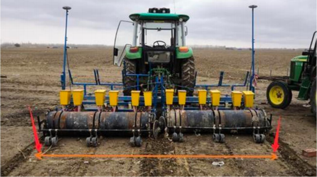

 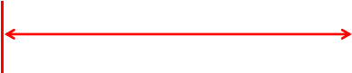

##### 6.1.2.5 Implement Offset

**Implement offset** is the distance between the center point of the vehicle and the center point of the implement. When both centers coincide, the offset is **0**. Mark the center points of both the vehicle and the implement when measuring.

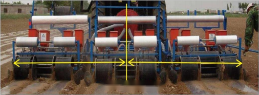

##### 6.1.2.6 Distance from Hitch Point to Working Point

The straight-line distance between the **connection point (hitch point)** of vehicle and implement and the working point of the implement.

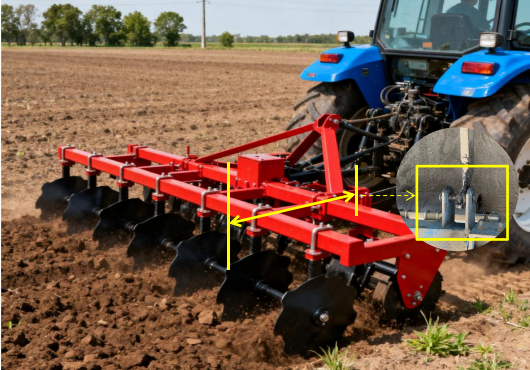

#### 6.1.3 U-turn Parameters

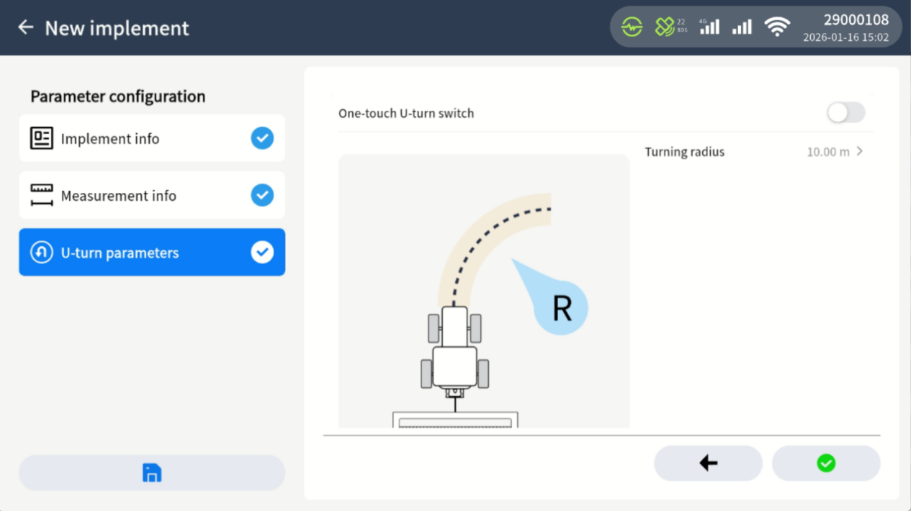

| No. | Function | Description |
|:--:|----|----|
| 1 | One-touch U-turn switch | Turn the one-touch U-turn button on or off as needed. |
| 2 | Turning radius | Minimum turning radius of the vehicle for the one-touch U-turn. |
| 4 | ← | Operation button. Tap to return to **Measurement Information**. |
| 5 | √ | Operation button. Tap to activate and save this implement. |
| 6 | Save | Operation button. Tap to save the current configuration. |

## 7. Field Management

Quickly browse the current field information and satellite view from the main page. Tap the **Field Card** to open the field list, where you can create, delete or edit a field.

### 7.1 Field List

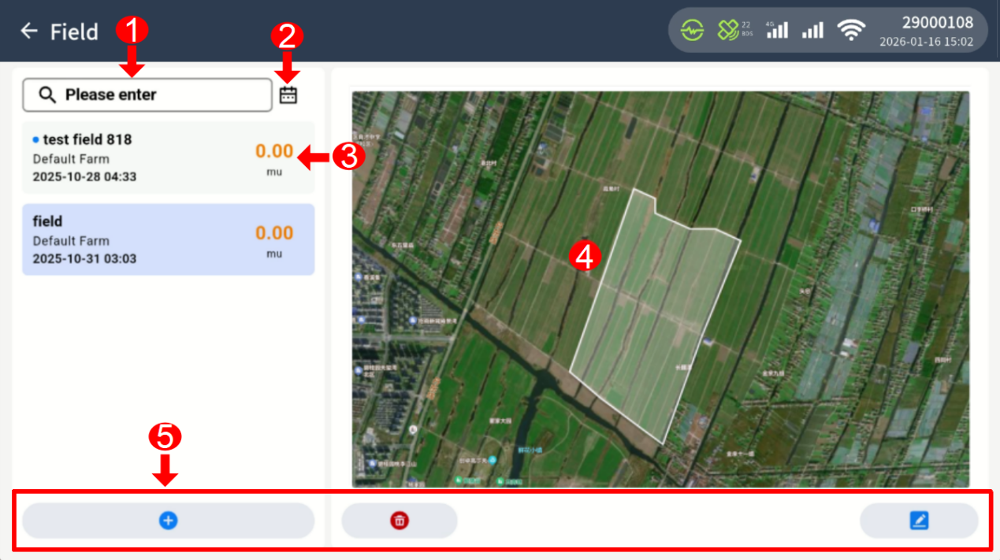

1. Quickly search for fields by entering keywords.
2. Switch between two sorting methods: **sort by distance / sort by time**.
3. Marks the field assigned to the current task.
4. View the satellite image of the selected field.
5. Create, delete or modify field information.

### 7.2 Create a New Field

Tap the **＋** button on the screen.

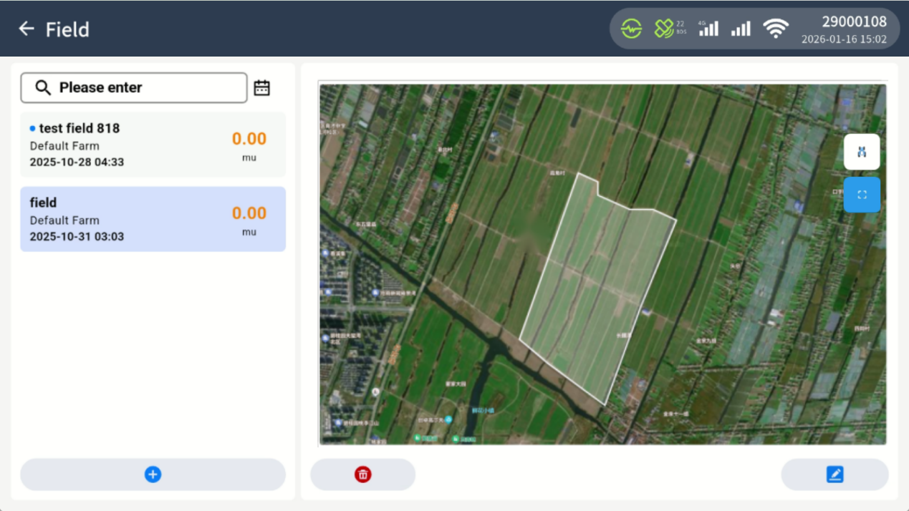

A pop-up window for creating a new field appears.

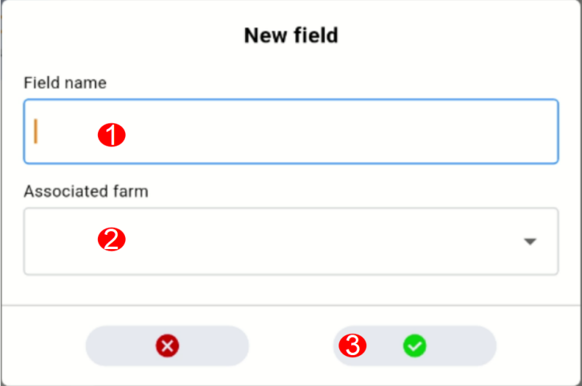

1. Enter a unique **field name**.
2. Select the **associated farm**. The list is synchronized with the platform; farms can also be added with the mobile app.
3. Tap  to finish creating the field. The new field is automatically added to the field list and selected.
4. Tap  to exit without creating a field.

### 7.3 Delete Field

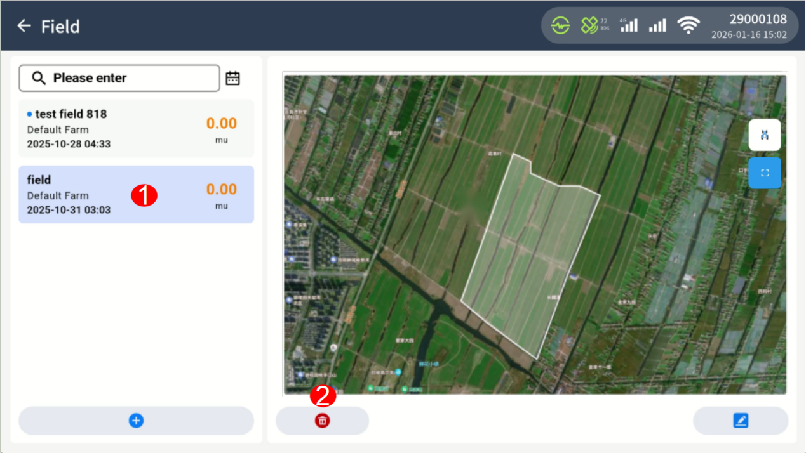

Select the field to be deleted in the field list and tap **Delete**. In the confirmation pop-up, tap  to complete the deletion. The field list is updated automatically.

> **Notes:**
>
> - When a field is deleted, all tasks associated with it are deleted as well.
> - If there are still pending tasks in the field, proceed with caution.
> - The field assigned to the current task cannot be deleted. When this field is selected, the **Delete** button is grayed out.

## 8. Workbench

When the account is logged in, the vehicle has been created and calibrated, the implement has been created and a task has been created, tap the **Workbench** icon.

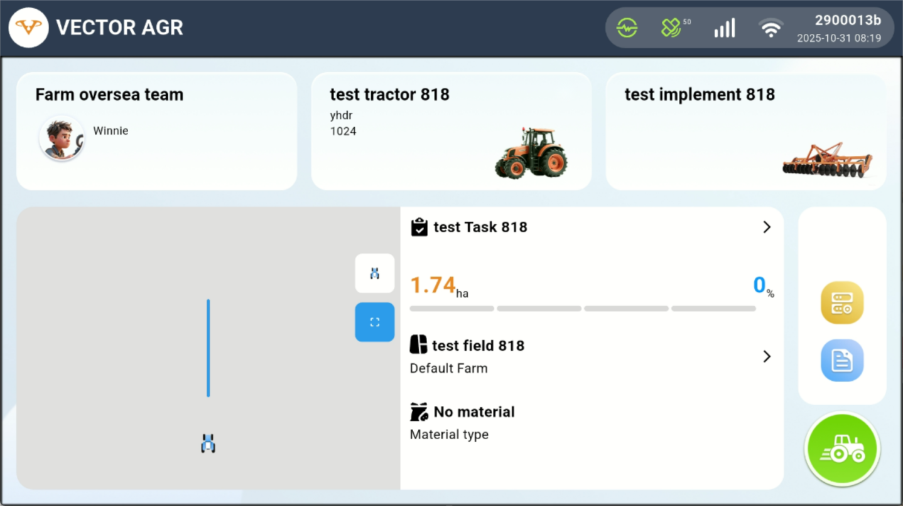

The screen switches to the **Workbench** interface.

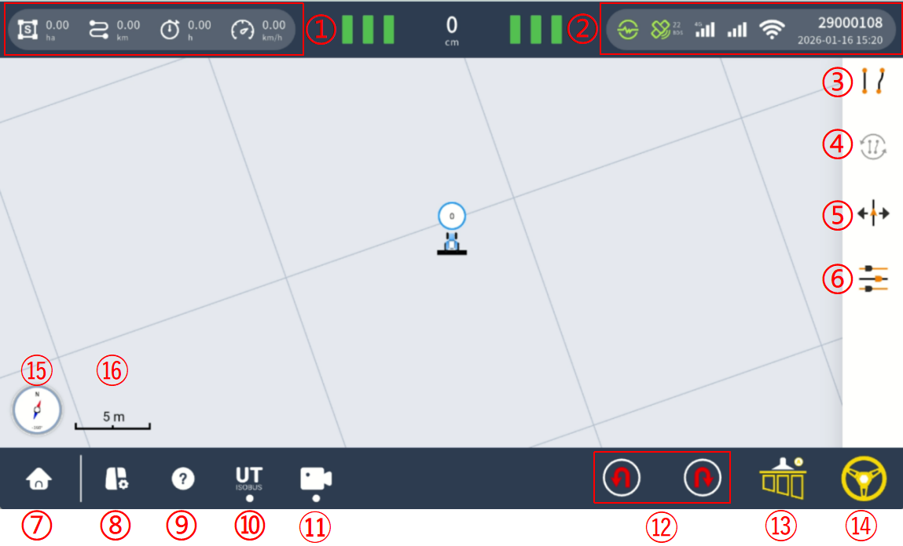

1. **Operation status bar:** shows the current operation status, including worked area, driven distance, working hours and average speed. Tap the icon group in the upper-left corner on any screen to open the quick task pop-up; tap the icon again or anywhere on the screen to close it.
2. **Settings:** shows system information such as settings, satellite status, SIM status, device ID and current time. Tap the icon group in the upper-right corner on any screen to open the settings window; tap the same area again to close it.
3. **Reference line:** create a new navigation line.
4. **Reference line switching:** switch to another reference line.
5. **Nudge:** fine-tune the position of the navigation line.
6. **Control parameters:** adjust the vehicle's steering and navigation control parameters.
7. **U-turn parameters:** turn the one-touch U-turn on or off.
8. **Home:** return to the home screen.
9. **Field manager:** view details of the current field and modify its elements.
10. **Help:** remote assistance, AI voice assistant, download materials and tutorial videos.
11. **ISOBUS settings:** adjust the ISOBUS parameters.
12. **Camera switch:** turn the camera on or off.
13. **One-touch U-turn:** make a U-turn to the left or right.
14. **Track switch:** show or hide the worked tracks.
15. **Auto drive switch:** enable or disable automatic steering.
16. **Compass:** shows the current heading.
17. **Scale:** map scale.

## 9. Field Manager

At the bottom of the workbench, tap the **Field Management** icon.

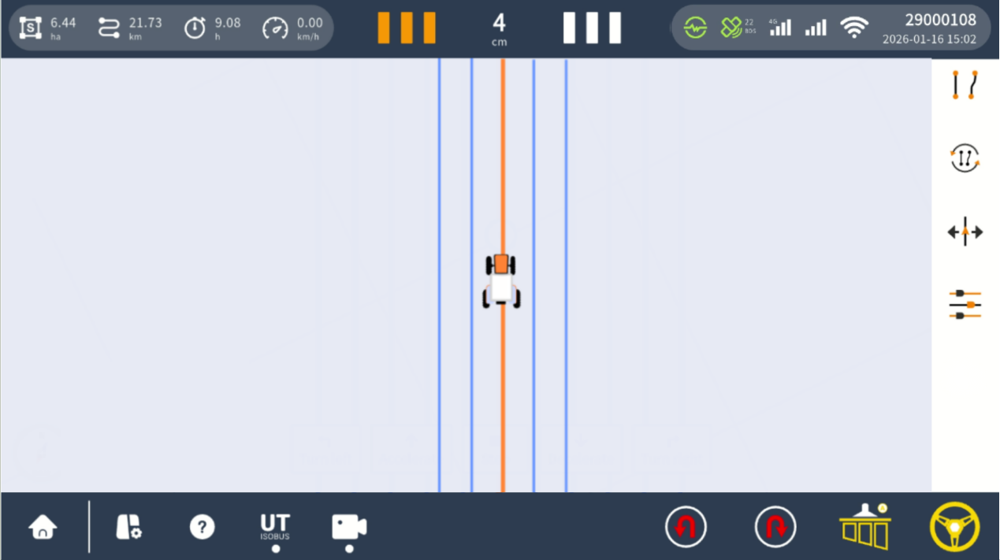

The screen switches to the **Field Manager**.

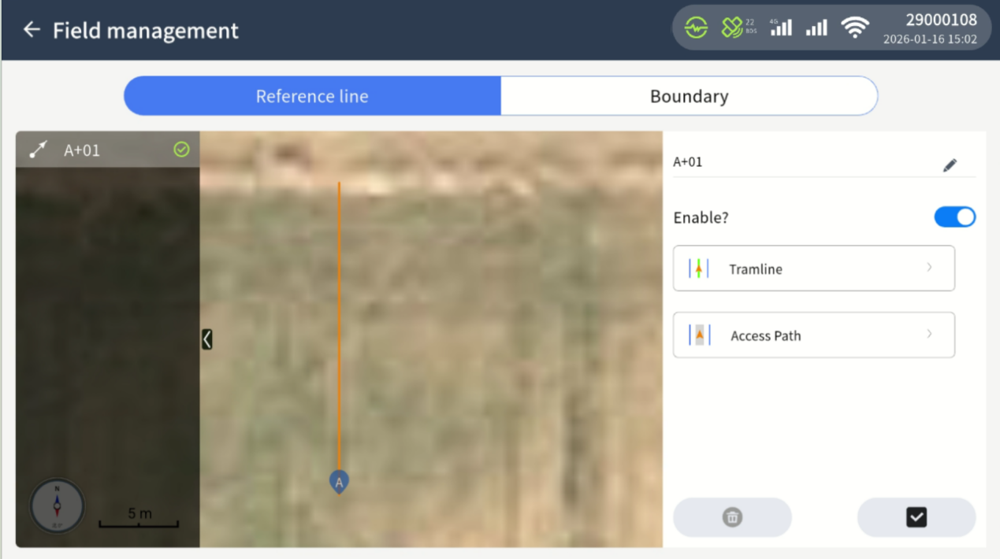

Tap the top menu to view details of the current field and modify its elements.

- **Reference line:** rename, enable/disable, delete, load, set tramlines or access paths.
- **Boundary:** add **headlands** to the boundaries of the current field.

## 10. Work Mode

Tap the **Navigation Tool** button , select the desired reference line  and choose the work mode. Tap  to continue.

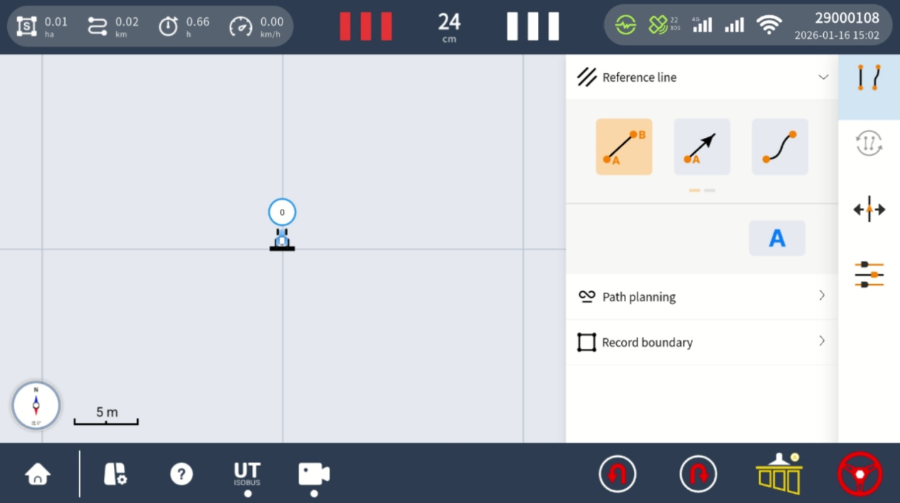

Available work modes include **AB line**, **A+ line** and **curve**, among others.

### 10.1 AB Line

1. Select the **AB line** work mode.

   

2. Drive the vehicle to the start of the field, facing the working direction, and tap **Point A** on the screen to set point **A**.

   

3. Drive manually to the end of the field and tap **Point B** to set point **B** and finish the AB line. The minimum distance between A and B is 5 m.

   

4. Tap **Confirm** (green √) to finish. You can tap **Cancel** (red ×) at any time to abort.

    

> 
>
> While setting the AB line, the vehicle must not work (drive with the implement out of work).
>
> Each time you change fields, the AB line must be set again. If the work is not finished on the same day, you can load the previous field and continue the next day.

### 10.2 A+ Line

1. Tap the **A+ line** mode icon.

   

2. Enter the heading in degrees. Each time you switch to A+ line mode, the system takes the current vehicle heading as the default value, so you can set it up quickly from the current heading.

   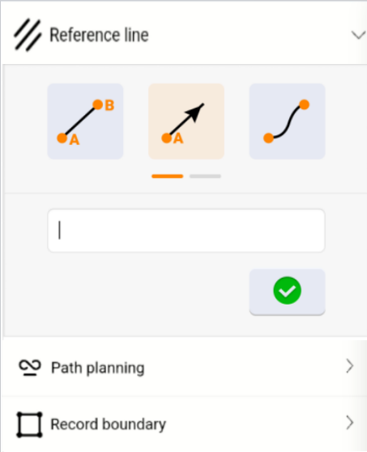

   Heading reference: true north = 0°, east = 90°, south = 180°, west = 270°.

3. Tap **Confirm** to finish.

### 10.3 Curve Mode

In **curve mode** you can record a route that contains both curved and straight segments. **Vectoris Pro** uses the recorded route as a reference line and automatically generates parallel navigation lines on both sides at a spacing equal to the current implement width.

1. Tap the **curve mode** icon.

   

2. Drive the vehicle to the position where the recording should start.
3. Tap **Record** to start recording.

   

4. The device marks the starting point on the map and shows the driven track from the start to the current position as a dotted line.
   - To add a straight segment, tap **Pause Recording** (the distance driven during the pause is recorded as a straight line).

     

   - To continue recording the curve, tap **Resume Recording**.

     

5. When the vehicle reaches the end of the route, tap **Confirm** to finish. You can tap **Cancel** at any time to abort and discard.

### 10.4 Circle

In **circle** mode, **Vectoris Pro** offers three methods to define a circle, so you can choose the best one for the situation in the field.

1. Tap the **circle mode** icon.

   

2. Tap the **circle creation method** box and choose the method from the drop-down list.

   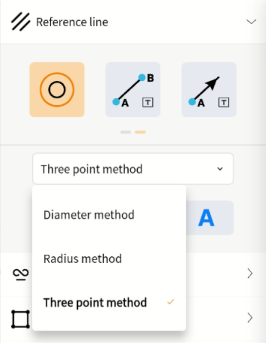

   - **Diameter:** define the circle by recording a diameter path of at least 15 m.

     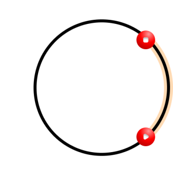

   - **Radius:** define the circle by setting point O (center) and point A (any point on the circumference).

     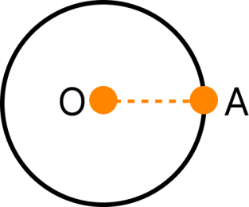

   - **Three points:** define the circle by setting three different points A, B and C on the circumference.

     

### 10.5 AB Line (Coordinate Input)

If you already have the coordinates of points **A** and **B**, you can create an **AB line** directly by entering them.

1. Tap the **AB line (coordinate input)** icon.

   

2. Enter latitude and longitude of point **A** and point **B**, then tap  to create the AB line.

   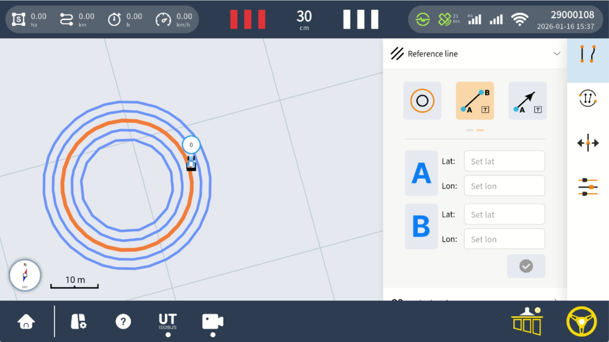

> 
>
> Latitude and longitude must be entered in decimal degrees (DD), with up to 7 decimal places.

### 10.6 A+ Line (Coordinate Input)

Like the AB line, **Vectoris Pro** can also create an **A+ line** from coordinates.

1. Tap the **A+ line (coordinate input)** icon.

   

2. Enter latitude and longitude of point **A** and the target heading, then tap **Confirm**.

   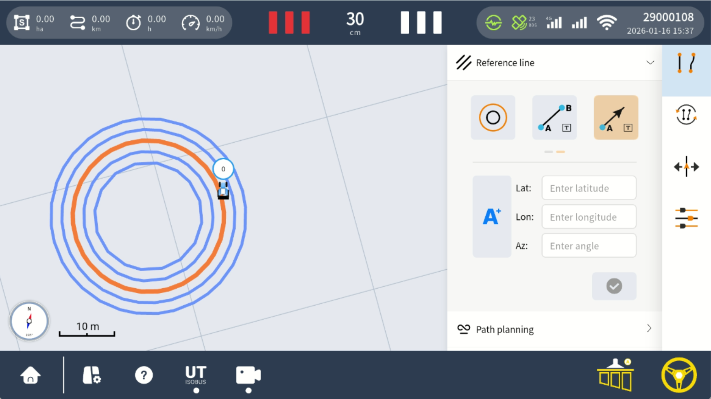

## 11. Auto Driving

| Icon | Status | Function |
|:--:|----|----|
|  orange | System is ready for auto driving | Tap to start auto driving |
|  green | System is auto driving | Tap to stop auto driving |
|  red | System cannot start auto driving | Check for faults |

## 12. Nudging

To fine-tune the position of the navigation line, tap **Nudge** on the right side of the workbench.

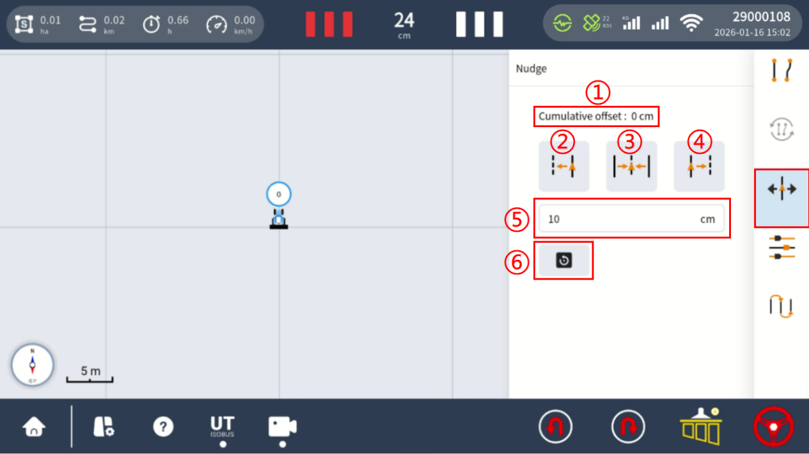

| No. | Name | Description |
|:--:|----|----|
| 1 | Cumulative offset | Total offset relative to the original navigation line (0). "–" = offset to the left, "+" = offset to the right. |
| 2 | Nudge left | Shift the navigation line to the left. |
| 3 | Nudge to here | Move the navigation line to the vehicle's current position. |
| 4 | Nudge right | Shift the navigation line to the right. |
| 5 | Value input | Nudge step (unit: cm). |
| 6 | Reset navigation line | Reset the navigation line to its original position. |

> 
>
> When the workbench is opened with a new task, all nudges are reset automatically.

## 13. Common Functions

### 13.1 Operation Status Bar

Shows operation data in real time. During operation (with or without auto driving) tap the function area in the upper-left corner to open a pop-up window. Tap the area again or any empty area to close it.

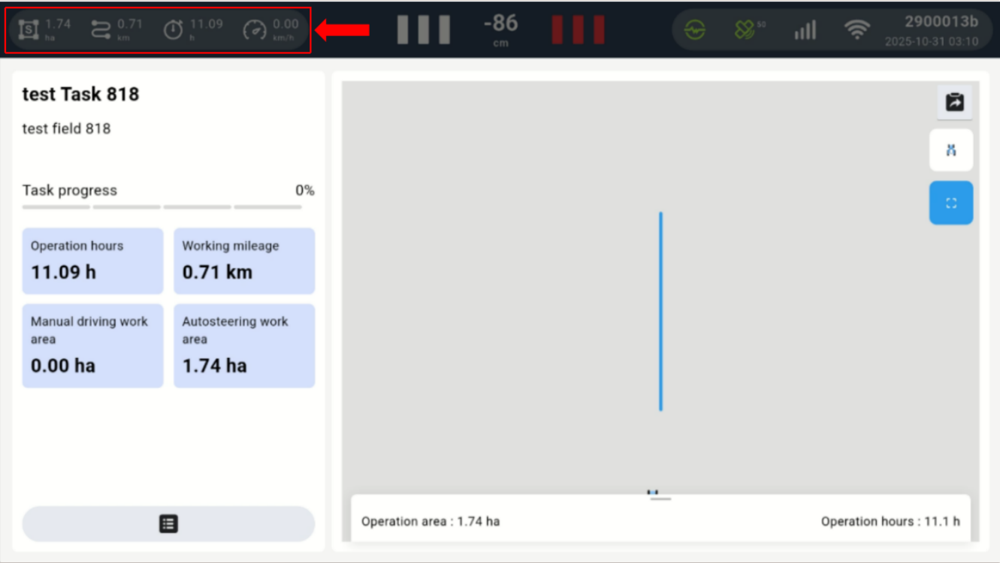

| No. | Data | Description |
|:--:|----|----|
| 1 | Task name | Name of the current task. |
| 2 | Working hours | Accumulated auto driving time. Counting pauses when auto driving is off. If track recording is set to manual, manual driving time is included. |
| 3 | Working distance | Accumulated auto driving distance. Counting pauses when auto driving is off. If track recording is set to manual, manual driving distance is included. |
| 4 | Manual driving area | Total area worked with manual driving. |
| 5 | Auto driving area | Total area worked with auto driving. |
| 6 | Task list | Opens the task list to view and select tasks. |

### 13.2 Settings

Tap the **status icon area** in the upper-right corner of any screen to open the **Settings** drop-down. Tap again to close it.

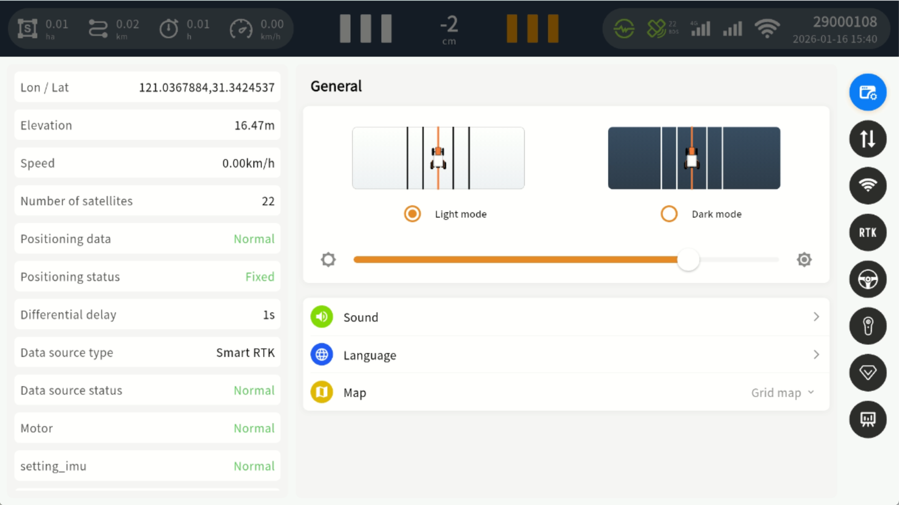

| Icon | Description |
|:--:|----|
|  | **General settings** – theme, screen brightness, volume, alarm tone, unit system and satellite map. |
|  | **WLAN settings** – connect to and configure Wi-Fi networks. |
|  | **Mobile network settings** – view SIM card information and configure the mobile network. |
|  | **RTK settings** – configure and manage correction sources. |
|  | **Navigation settings** – navigation mode and parameters. |
|  | **External devices** – modes for accessories such as 360° cameras or wired joysticks. |
|  | **License management** – basic services, SBAS services and paid software features. |
|  | **Demo mode** – enable/disable and configure the demo mode. |

### 13.3 Pass-to-Pass Alignment

1. On the home screen, tap the **Implement Card** to open the implement list and select the implement whose **pass-to-pass line** needs adjustment.

   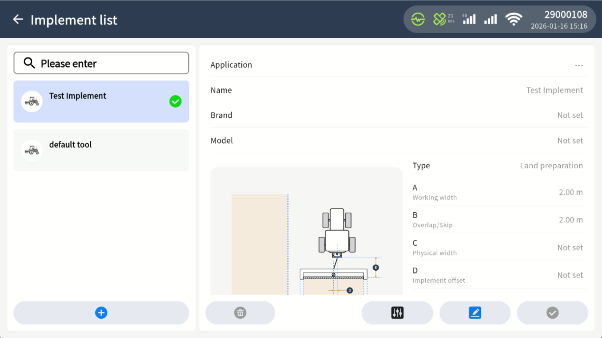

2. Select **Measurement Information**, where you can adjust the parameters manually.

   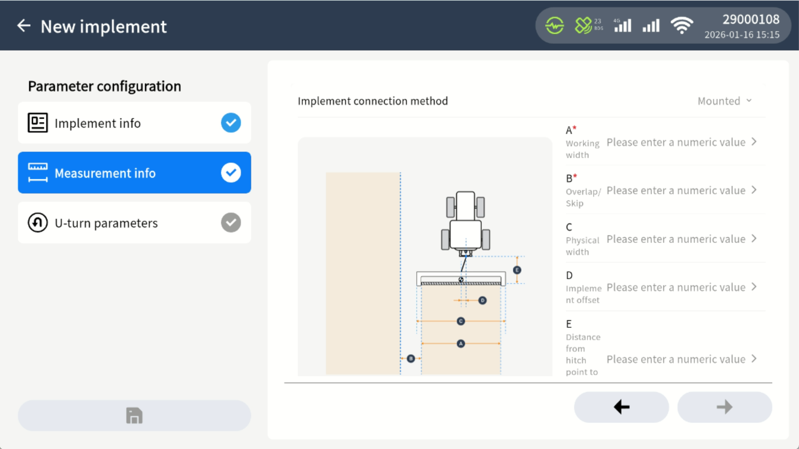

3. **Three-pass calibration:** drive the tractor three times up and back. From the vehicle position after the last pass, determine whether the deviation is on the **left** or **right** side. Enter the measured **pass-to-pass line width** and tap **Confirm**.

> 
>
> Before calibrating, make sure the implement parameters are correct. The sum of the two measured spacings (left and right) should equal **twice the theoretical pass-to-pass line width**.
>
> *Example:* left pass-to-pass line 62 cm, right 70 cm, theoretical 66 cm: 70 + 62 = 66 × 2, so the implement parameters are correct.

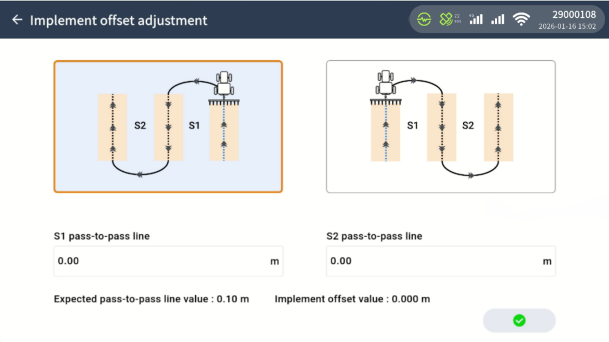

### 13.4 Steering Control Parameters

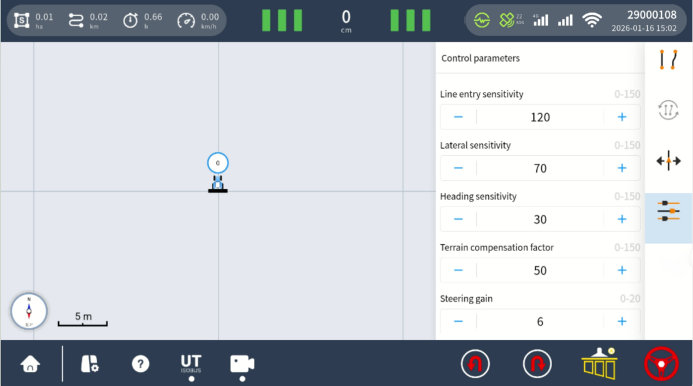

- **Line entry sensitivity** – responsiveness of steering corrections while following the line.
- **Lateral sensitivity** – timing of steering wheel adjustment.
- **Heading sensitivity** – amplitude of steering corrections.
- **Terrain compensation factor** – weight the system uses to compensate for terrain variations.
- **Steering gain** – frequency of steering wheel oscillation.

### 13.5 Version Management

Tap the **Version Management** icon on the home screen.

Then select the upgrade method in the lower-right corner of the screen:

- **Local upgrade:** connect a USB flash drive and install the selected version.
- **Online upgrade:** perform a network check. If a new version is available, the system prompts you to download and install it.

# V. HD Digital Ag

Field boundaries, implements, materials, prescription maps and tasks can be created on the platform and synchronized with Huida HD auto steering systems, the HD agricultural drone and the HD Ag mobile app, giving seamless data synchronization across all three platforms.

- HD Ag platform: [www.huidaag.com](http://www.huidaag.com)
- HD Ag mobile app:

# VI. Common Problems

## 1. Equipment Information Fault Analysis

| Status bar | Information | Analysis |
|----|----|----|
| Positioning status | Fixed | Normal |
| | Floating | The device receives weak or insufficient satellite signals. |
| | Pseudorange | The base station signal is not received. |
| | Single point | Only a single positioning solution is available. |
| | Invalid | No satellite signals are received. |
| WAS | Not connected | Check the connection of the main wiring harness. |
| | Connected | Normal |
| Heading wheel angle | Uninitialized | Can happen when the vehicle stands still for a long time. Start the vehicle and drive forward above 1.6 km/h to reinitialize. |

## 2. Common Fault Analysis

| Fault | Cause | Solution |
|----|----|----|
| Terminal does not start | Fuse blown | Replace the fuse |
| Engaged but no steering movement | Motor failure | Replace the motor |
| Black or flickering screen | Terminal fault | Replace the terminal |
| | Terminal wiring harness damaged | Replace the terminal wiring harness |
| | Receiver main wiring harness without power | Replace the main wiring harness |
| | Battery drained / power harness loose | Charge the battery or tighten the power connection |
| Auto steering stops unexpectedly | Bad wiring harness connection | Check and secure the wiring harness connection |

# VII. Equipment Maintenance

- To ensure normal operation and service life, maintain the system strictly according to the specified requirements.
- Unauthorized disassembly or assembly of the system's main components is strictly prohibited. If necessary, contact authorized after-sales service personnel promptly.
- Operate the system strictly according to the user manual.
- Inspect all system screws, wiring harnesses and connectors weekly – such as the mounting screws of the **controller**, the **angle sensor** and the **data cable connectors**. If anything is loose, detached or damaged, tighten or repair it immediately.

**Steering wheel motor maintenance:**

- Keep the steering motor clean. Do not let dust, soil or other debris accumulate on the motor for long periods.
- Do not wrap the motor with cloth, dust covers or similar materials during use, to ensure proper ventilation and cooling.
- Before each season, check that the transmission runs smoothly, that the coupling is concentric and that the gears move freely. If anything jams, find and eliminate the cause before operation.

# VIII. Wiring Harness Connection Diagram

# IX. Three Guarantees Service

To protect users' legitimate rights and interests, provide better customer service, ensure that the company fulfills its after-sales commitments and eliminate user concerns, these detailed rules are hereby established.

The **Three Guarantees Service** (repair, replacement and return) manual is supplied with each product, one per machine. Users should complete the **User Registration Card** immediately after purchase.

The company provides the Three Guarantees Service in accordance with relevant laws and regulations, such as the *Product Quality Law of the People's Republic of China* and the *Consumer Rights Protection Law of the People's Republic of China*.

The validity period of the Three Guarantees starts on the invoice date. Time needed for repairs and waiting time caused by a shortage of parts is not counted toward the validity period.

a. If a quality issue is confirmed within **five (5) days** of purchase, the consumer may choose a **refund or replacement**.  
b. For a replaced product, the Three Guarantees period starts again on the replacement date.  
c. If the product still does not work properly after **two repairs** within the validity period, the company replaces the faulty **system components** with new ones.  
d. During the **busy farming season**, for failures within the service area: simple faults are fixed within **2 days**, complex faults within **5 days**.

To receive the Three Guarantees Service, users must bring this manual and the purchase invoice to an authorized service point and complete the **Three Guarantees Repair Service Record Form**.

a. In regions without the company's service network, the **local agent** is responsible.  
b. In regions without an agent, service personnel may contact the **manufacturer directly**, providing the **Repair Service Record Form**.

Routine maintenance, servicing, adjustment and inspection described in the **product manual** are **not covered** by the Three Guarantees Service.

The Three Guarantees validity period for the **complete system** is **one (1) year** and covers all hardware components.

**Exclusions**

The following cases are not covered; **paid repair** is offered as appropriate:

a. Premature wear or malfunction caused by **improper use, maintenance or care**, e.g. operating the system outside the conditions in the manual, not following instructions, or changing voltage parameters without authorization.  
b. Malfunctions caused by **unauthorized modification, adjustment or disassembly** of components prohibited by the product manual.  
c. Missing **Three Guarantees certificate** and **valid purchase invoice**, or no proof that the product is within the validity period.  
d. Product model or specification on the **certificate/invoice** does not match the actual product or has been altered.  
e. The product's original condition was not preserved after a fault, or it was **handled without authorization** before technical inspection, making the cause impossible to determine.  
f. Damage or malfunction caused by **incorrect operation**, such as leaving the cab while the vehicle is in auto driving mode.  
g. Damage caused by **force majeure** (e.g. natural disasters).

> 
>
> If these rules conflict with national regulations, the **national regulations prevail**.

## Warranty Certificate

| | | | |
|----|----|----|----|
| **Product information** | Product name | Auto Steering System | |
| | Product model | | Terminal number |
| **User information** | User name | | User address |
| | Phone | | Postal code |
| **Sales information** | Dealer | | Dealer address |
| | Phone | | Postal code |
| | Date of sale | | Price |
| | Invoice number | | Dealer stamp |
| **Manufacturer** | Company name | | Company address |
| | Postal code | | |
